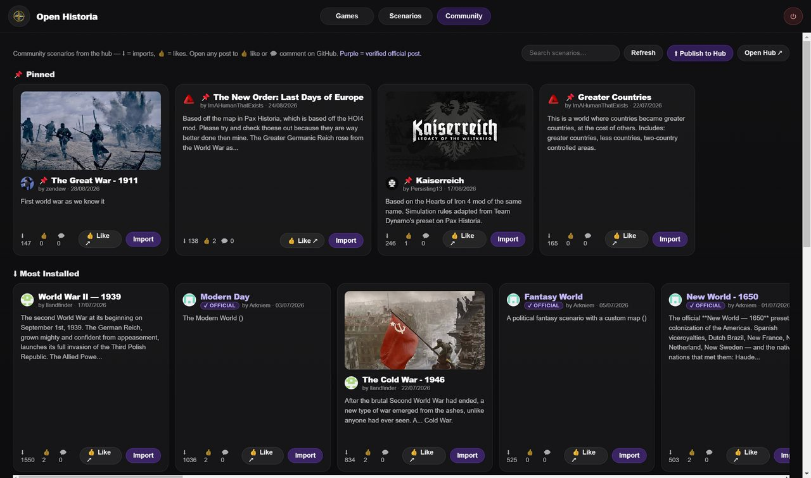

The Community Hub is where scenarios are shared. It is the **Community** tab of the main menu,
and it is where every scenario except Modern Day comes from — including the official presets.

You will also see it called the **Scenario Hub**; they are the same thing.

*The hub's shelves. Install counts and likes are real, and a ✓ Official badge marks a verified official post.*

## Browsing

The tab opens with a **📌 Pinned** shelf: the scenarios the hub's maintainers have chosen to
feature. Only hub collaborators can pin something, so this shelf is curated rather than gamed.
Below it, the whole hub in three rows:

- **⬇ Most Installed** — by real install counts.
- **👍 Most Liked** — by 👍 reactions on the post.
- **🕐 Most Recent** — newest first.

The search box above them looks through titles, descriptions and authors.

<b>On beta the shelf is called 📌 Featured</b>, and everything else is one
<b>Browse Community</b> grid you sort with <b>Most Installed</b>, <b>Most Liked</b> or
<b>Newest</b>. Beside the search box, <b>Start date</b> takes a <b>From</b> and a <b>To</b> — a
year such as 1914 or 218 BC, or a full date — and shows only the scenarios that begin between the
two; <b>Clear</b> empties both. A scenario whose start date the hub does not know drops out while
either box is filled. Each card also says what your library already holds of it — <b>In your
library</b>, <b>Update available</b> or <b>Edited copy in your library</b> — and its button asks
again before importing a second copy.

A scenario with a **✓ Official** badge was posted by a member of the Open Historia team —
verified by GitHub, from who posted it, not by what the title says. Anything without
one is community work, which is most of the hub and where the more inventive scenarios tend to
be. Only posts whose file the hub has checked are listed at all (see below).

Click any scenario for its detail view: description, cover image, counts, and
**▶ Import & Play**. Likes and comments live on the scenario's GitHub post; **👍 Like ↗** opens
it.

## The official presets

| Scenario | Start |
| --- | --- |
| Rome | 117 AD |
| Medieval | 1200 AD |
| Mongol World | 1300 AD |
| New World | 1650 |
| Bronze Age | 1200 BC |

That list is not exhaustive — Modern Day, a Fantasy World preset and other scenarios the team
has posted carry the official badge as well, and the pinned shelf changes as new work is
featured. Treat the hub itself as the authority rather than this table.

All one click to import.

## Importing

**Import & Play** downloads the hub's checked copy of the scenario, installs it into your library
and takes you to it in your **Scenarios** tab, where **New Game** starts it. **Import** on a card
does the same without leaving the hub. From then on it behaves exactly like a built-in scenario —
it is yours, it works offline, and you can edit or clone it.

<b>On beta, Import &amp; Play goes straight on to choosing your
country</b>, and a scenario already in your library offers <b>▶ Play your copy</b> instead. A
scenario made on a detailed map names that map rather than carrying it: in the desktop app, the
last step of installing it offers the map's download, with its size.

A bundle carries the map, cities, colours, flags and any custom basemap the author used —
including a map uploaded as a tile archive rather than drawn in the editor — so what you get is
what they built. A game you start from an imported scenario remembers where it came from, so
exporting that game later does not carry the map inside it: the receiver can fetch it from the
hub.

## Updates

If an author ships a newer version of a scenario you imported, its card in your Scenarios tab
shows **⬆ Update** in place of **New Game**.

Updating replaces the scenario in place. **Games already running on the old version keep
working** — a game is a copy taken at the moment you started it, so it is not disturbed.

A scenario you imported with a version of the game from before October 2026 asks for an update
as well, with a note on its card saying why. The hub now checks every file before the game will
download it, and a copy from before that was never checked: updating swaps it for the hub's
checked copy. If you have edited that scenario the game asks first, because updating replaces
your changes — clone the scenario beforehand if you want to keep them.

## Suggesting changes

Improved a scenario you downloaded from the hub? Send your changes to its author, who accepts or
rejects each one, like tracked changes.

- Open the scenario from your Scenarios tab with **Edit**. Once you have changed and saved your
  copy, **Suggest changes** compares it with the post's and lists what changed, outside the map
  and on it. Add your name and a note for the author if you like.
- **Save the file and open the post** saves a small file of just those changes and opens the
  scenario's post with your comment ready to paste. Drag the file into the comment and click
  **Comment**.
- The author's game finds the suggestion on their post, once the hub has checked it, and their
  scenario's **Community** card offers **Review**. Changes outside the map are accepted or
  rejected one by one, or with **Accept all** and **Reject all**; changes on the map open in the
  map editor, listed beside the map and marked on it. **Reject all from @…** puts away everything
  one person suggested, on all of that author's posts.

Changes you suggest are released under CC BY 4.0, like the scenario they are for.

**Unlink from the community post** makes a downloaded scenario your own: it stops following the
post, and you can no longer suggest changes to it.

<b>On beta, unlinking is for good</b>: a scenario cannot be linked to a post
again. An author who stops looking for suggestions on a post cannot link it back either;
publishing the scenario again makes a new post.

## Publishing your own

**Everything you publish is released under CC BY 4.0.** Every scenario made in Open Historia that is
posted or shared in any way is released under the
[Creative Commons Attribution 4.0 International](https://creativecommons.org/licenses/by/4.0/)
licence, and that cannot be taken back. The same goes for changes you suggest to somebody else's
scenario. Only publish what you made yourself, or what you may share under this licence. The game
says so before you publish, the post form asks you to confirm it, and the exported file carries it.

Build a scenario in [the map editor](/wiki/editor/), then press **⬆ Publish to Hub** in the
Community tab and pick it. The game saves the scenario as a .zip — and its cover image beside it,
since GitHub cannot show a picture from inside a zip — and opens the hub's post form with the
details filled in. Drag both files into the **Description** box, tick the licence box, and
submit. If the post form did not open, **Open the GitHub post ↗** opens it.

<b>On beta the game warns when the file is too large for GitHub</b>, which
takes attachments of up to 25 MB. Imported regions are the usual cause: in the map editor, select
the scenario's most detailed regions, press <b>Simplify</b>, save, and publish again.

Some things worth doing before you publish:

- **Write the description properly.** It is what people read on the card.
- **Set a cover image.** Scenarios without one get skipped.
- **Fill in the *World Before Round One* briefing.** It is what stops a campaign on your map
  feeling like the world began at turn one.
- **Set the deployable troop types.** No air force in 1200 AD.
- **Consider the Simulation Rules field.** House rules injected into the world's instructions are
  what make an alternate-history scenario actually behave like its premise.

## Basemaps and flags

The hub carries more than scenarios. **Basemaps** are posted separately and appear in the
editor's Community tab, and **flag packs** can be shared and installed the same way. A scenario
bundle can also carry its own basemap.

<b>On beta the hub also holds music and detailed maps.</b> A scenario's
Music tab picks the tracks it plays as it opens, in play, at war and in the War Room from the
hub's music list, which only the hub's contributors can add to. Detailed maps — large terrain
maps for the desktop app — are posted on the hub too and checked like every other file.

## How it works underneath

The hub is a GitHub repository — `Open-Historia/Open-historia-scenarios` — where every issue is
a posted scenario. Likes are GitHub reactions; the pinned shelf is a label only collaborators can
apply.

Every file posted to the hub is checked before the game will touch it. A post shows up in the
game once its file has passed and the hub has released a checked copy of it — usually a minute or
two after it is posted — and a file that fails is refused with a comment on the post saying why.
The game downloads only those checked copies, and shows a post's pictures from them too. Once a
post's file is released the hub closes the post, so in a web browser the released scenarios are
under the repository's closed issues.

The list itself comes from one small index the hub publishes, not from GitHub's API, so browsing the tab costs none of the hourly allowance GitHub gives each player.
The game keeps that index for five minutes, so a brand-new post may take a moment to appear; if
the index cannot be read, the tab says the hub's list cannot be read yet rather than showing
anything unchecked.

Install counts are GitHub's own: how many times a scenario's checked file has been downloaded
from the hub. They count downloads rather than people, and the game reports nothing itself.

Because it is GitHub, you can browse the hub in a web browser, and a scenario you cannot reach
in-game can always be downloaded from the repository directly and imported with the library's
**Import** button.

## Next

- [The map editor](/wiki/editor/) — building something worth publishing.
- [Starting a game](/wiki/new-game/) — playing what you imported.
- [Saves and rollback](/wiki/saves/) — importing and exporting by hand.
