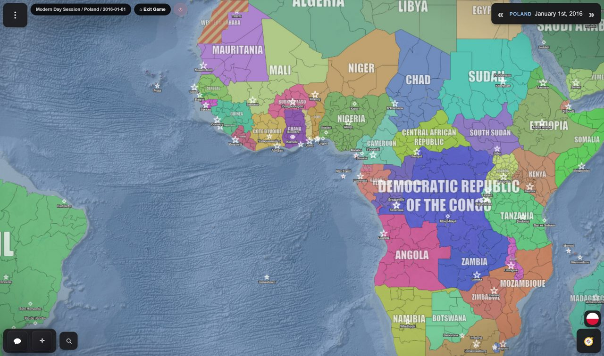

Almost the entire screen is map. Everything else sits around the edges and gets out of the way
when you are not using it.

*The game menu, session pill and date pill along the top; the toolbar bottom left; your flag and the advisor bottom right. Everything else is map.*

## The edges at a glance

| Where | What |
|---|---|
| **Top left** | **☰** the game menu, the session pill — the game, your country, the date — and **⌂ Exit Game**. |
| **Top right** | The date pill, with **«** events and **»** time skip. |
| **Bottom left** | The toolbar: **Chat**, **✦ Actions** and **Projects & Operations**, with search beside it. On beta: **Chat**, **✦ Actions** (with Projects & Operations as its second tab) and **Rostra**, the social network. |
| **Bottom right** | Your flag, and the **Advisor** button, which opens a drawer with Advisor and Stats. |

<b>On beta the bottom corners hold more.</b> Bottom right, your flag opens
the <b>Country</b> panel (on a phone, your country's name in the date pill does), the
<b>Advisor</b> button opens the advisor alone, and under them is the map switch,
<b>Political</b> or <b>Diplomatic</b>, with a legend (see
<a href="/wiki/world-map/#map-modes">map modes</a>). Bottom left, while your troops are on a
battlefield, a red <b>War room</b> button stands beside the toolbar (see
<a href="/wiki/war-room/">the War Room</a>).

Panels overlap in a fixed order, so opening the advisor never buries the thing you were reading,
and the main menu always comes out on top. On a phone the whole interface fits the screen and the
advisor drawer can be closed again like any other panel.

## The map itself

Clicking things is the primary way you interact with the world.

- **Click the map** → a card for the country and the region under your cursor. The country row
  has **💬** to open a diplomatic chat, **⧉** to copy its name and **ⓘ** to open its panel; the
  region row names the region. Where the region is occupied or contested the card says who is
  sovereign, who controls it and who claims it, and where a group controls it, which group.
- **The country panel** → flag, details, alternative names, related events filtered by
  importance (All, Major, Minor), an **Advisor Report** — an AI intelligence reading — on
  request, and **Open Diplomacy**. On beta it also has **Stats**.
- **Click a unit** → an intelligence card describing the formation — what it is, whose it is,
  how strong, and what it appears to be doing.
- **Click a city or structure** → its name, population, and what it is.

<b>On beta the region row's ⓘ opens the region's details</b> — its cities
and its neighbours.

Drag to pan, scroll to zoom. See [the world map](/wiki/world-map/) for what the colours,
stripes and labels mean.

<b>On beta the map also turns and tilts.</b> With a mouse, drag with the
right button: sideways turns the map, up and down tilts it, and the wheel still zooms. On a
trackpad, click and drag to pan, and pinch or drag with two fingers to zoom; hold Shift while you
drag with two fingers to turn and tilt the map, both at once. Shift with the arrow keys turns and
tilts it too, and all of this works in the War Room as well.

## The date pill and time

Top right, always visible: your country and the current in-game date.

- **»** opens the **time skip** panel — fixed jumps from six hours to a year, a custom amount,
  auto-jump, **↩ Undo last turn**, and today's AI request count.
- **«** opens the **Events** panel — the events from the last jump, replayed one at a time,
  with the map animating as each lands, and **✋ Intervene here** to stop the round where you
  want to act.

Full detail in [time and turns](/wiki/time/).

## The toolbar

Three buttons, bottom left.

### Chat

Diplomacy. Two tabs:

- **Diplomacy** — every conversation you are part of. One-to-one threads with a country, or
  group threads with several. Countries open threads with you unprompted, and unread ones are
  badged.
- **Spy** — everyone else's conversations, as far as your intelligence service can read them.
  This is also where you deploy, recall, expel and turn agents.

<b>On beta the panel is headed Diplomacy</b>, with three tabs:
<b>Contacts</b> (your conversations), <b>Institutions</b> (the bodies countries belong to) and
<b>Intelligence</b> (your service), which has its own <b>Overview</b>, <b>Countries</b>,
<b>Operations</b> and <b>Reports</b>. Intelligence is where your agents take their orders.

See [diplomacy](/wiki/diplomacy/) and [espionage](/wiki/espionage/).

### ✦ Actions

Your order queue for the coming turn, under your **standing goal**. Write orders in plain
English, press **AI Suggestions** for ideas or **Brainstorm** to talk them through with the
advisor, refine a rough draft into a proper order, and delete anything you change your mind about.
Only planned orders show, under **Your Submitted Actions**; they clear as the turn resolves them.
On beta, **Suggested Actions** and **Your Submitted Actions** are two sections, and one is open at
a time. See [giving orders](/wiki/orders/).

### Projects & Operations

The board of long-running efforts — research programmes, construction, military and covert
operations, campaigns — that span many turns. You do not add to it by hand: events, your agents
and your advisor write it. See [projects and operations](/wiki/projects/).

<b>On beta the board is a tab of the Actions panel</b>: open <b>✦ Actions</b>
and choose <b>Projects</b>. Its old button in the toolbar opens <b>Rostra</b>, the social network
(see <a href="/wiki/diplomacy/#rostra">diplomacy</a>).

## The advisor drawer

The **Advisor** button, bottom right, opens a drawer you can resize by dragging its left edge. It
has two tabs.

**Advisor** — a chat with your own analyst. It reads the real game state and answers about it,
in markdown, sometimes with charts. Ask it anything about your position.

**Stats** — the national stat sheet. Two sub-tabs, **Diplomacy** and **Economy**: relations,
agreements and conflicts on one, the economy, strategic indices, stability, population and your
intelligence rating on the other. It retargets to **whatever country you last clicked**, so it
doubles as a way to read anyone.

<b>On beta Stats has a panel of its own.</b> The drawer is the advisor alone,
and the stat sheet is the <b>Country</b> panel, opened by your flag or by <b>Stats</b> in any
country's panel. It has four tabs —
<b>🏛 Politics</b>, <b>🤝 Diplomacy</b>, <b>📈 Economy</b> and <b>🏆 Ranking</b>, which sets the
countries side by side. While it is open, clicking a country on the map shows that one.

See [the advisor](/wiki/advisor/) and [national statistics](/wiki/statistics/).

## The game menu

**☰**, top left, opens the game menu, with four tabs:

- **Game** — the current campaign and **Game Management**: switch, duplicate, import or manage
  campaigns.
- **Tools** — **Cheats**, **Events / Timeline** and the **AI debug console**, one click away.
- **Settings** — four tiles, **General**, **Map**, **AI** and **Advanced**, each opening the
  full-screen settings workspace at that section. On beta there is a fifth, **Sound**.
- **Help** — the wiki, bug reporting, the privacy policy and the community links.

See [the settings reference](/wiki/settings/).

## Search

The **🔍** button beside the toolbar finds places by name as you type and flies the camera to
them. The game's own countries, cities and structures come first, under the names they have in
your campaign, then real-world places from an OpenStreetMap search. It only moves the camera — it
does not select or change anything. On beta it finds the world's groups and units too, and in an
invented world it leaves real-world places out.

## Cheats

☰ → **Tools** → **Cheats** is the game master's toolbox: the GM console, standing reminders every
AI is told, the event editor, interactive events, the history document, rolling back turns,
annexing territory, editing or creating countries, inspecting regions, the Force Manager,
difficulty, switching which country you play, and map features — and on beta, groups and puppet
states. See [cheats and the GM console](/wiki/cheats/).

## The main menu

The session pill's **⌂ Exit Game** returns you to the library, which has three tabs:

- **Games** — your campaigns, by last played and most played.
- **Scenarios** — the worlds you can start new games on, plus **Create Scenario**.
- **Community** — the [Community Hub](/wiki/community-hub/).

<b>On beta the menu is where the game starts.</b> Nothing loads until you
press <b>Play</b> on a game. The first time the game opens after an update, a vault door stands in
front of the menu: click its wheel to open it, onto a notice of what the update brings when there
is one. On a wide screen the pages sit on a rail down the left — <b>Games</b>, <b>Scenarios</b>,
and <b>Community</b> — with <b>Settings</b>, for what applies to every game, at its
foot; the Open Historia mark at the top opens the history of every update. <b>Games</b> has
<b>Continue Playing</b> and <b>All Games</b>; <b>Scenarios</b> has <b>Recently Used</b> and the
<b>Scenario Library</b>, with All, Yours, Community and Updates; what you delete waits at the
foot of each, on its <b>Recently deleted</b> shelf.

## If the screen is blank

A full-screen warning, **WebGL Not Available**, means the map cannot render. WebGL is sometimes
refused for a moment — a laptop switching graphics, a driver reset, a wake from sleep — so the
warning keeps checking for half a minute and reloads the game by itself if WebGL comes back;
**Reload** tries again by hand. If it stays, on a desktop it usually means graphics drivers or a
browser setting. See [troubleshooting](/wiki/troubleshooting/).

## Next

- [The world map](/wiki/world-map/) — reading what you are looking at.
- [Time and turns](/wiki/time/) — the button that actually advances the game.
