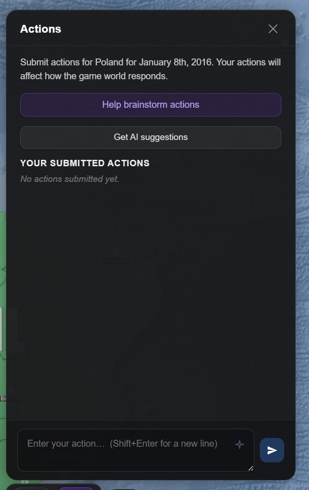

Orders are how you tell the world what your country is doing. They go in the **✦ Actions** panel
in the bottom toolbar, they are written in plain English, and they are resolved by the next
[time skip](/wiki/time/).

This is the single highest-leverage thing in the game. A campaign is largely decided by how well
you write these.

## Queuing an order

*The standing goal above, the order queue below. Orders are plain English and resolve on the next time skip.*

Type it into the composer at the bottom of the panel and press Enter (Shift+Enter for a new
line) or the send button. It appears under **Your Submitted Actions** as **planned** and stays
there until a turn resolves it.

<b>On beta the panel has two sections, and one is open at a time.</b> Once
you have asked for suggestions, <b>Suggested Actions</b> and <b>Your Submitted Actions</b> each
have a header with a count; opening one folds the other, so whichever you are working in has the
room.

You can queue as many as you like, but three or four substantial orders per turn is a sensible
working number. Beyond that the world has to divide one turn's worth of attention among all of
them, and each gets less.

**✕** removes an order you have changed your mind about. If the order was a troop
deployment that already showed on the map, deleting it also reverts that.

## The standing goal

Orders are what your government does this turn. The **standing goal**, at the top of the panel,
is the direction behind them — *"keep out of the war and grow the economy"*, *"unify Italy by
1870"*. Press **🎯 Set a standing goal**, write it, and **Save**; **Edit** changes it later. It is
locked while a turn runs.

Who hears it:

| | |
|---|---|
| **Your advisor** | Weighs its advice by it, says what brings it nearer, and says plainly when an order works against it. |
| **The time skip** | Treats it as a guiding philosophy, not an order: your own ministers handle the business your orders did not cover in its spirit. It never creates an action you did not order and never makes success likelier. |
| **AI suggestions** | Serve it where they can. |
| **Foreign leaders** | Never. A government's aims are its own. |

It is kept per country, so a renamed country keeps its goal, and switching country finds that
country's own. Undo and Intervene leave it as it is.

## The ✦ sparkle: refining a draft

Write a rough thought, press the sparkle, and it comes back as a properly formed order. Useful
when you know what you want but not how to phrase it — and useful for learning what a good order
looks like, because you can watch what it changes.

Nothing is committed until you queue it, so you can refine and rewrite freely.

## AI suggestions

**AI Suggestions** proposes orders based on your actual situation. They arrive as topic cards,
each with orders under it; clicking one queues it. **Brainstorm**, beside it, opens the advisor
instead, to talk a set of orders through with you.

Worth doing on a turn where you are not sure what to attend to — the suggestions are derived
from the real state of your country, so they tend to surface things you have not noticed. They
are not a to-do list, and following them uncritically produces a passive campaign.

## Writing orders that work

**Name the thing.** *"Move troops"* gives the world almost nothing. *"Move the 3rd Armoured
Division from Poznań to the Belarusian border"* gives it something to simulate.

**Say what you want to achieve, not what happens.** You are issuing an instruction, not writing
the outcome. *"Launch an offensive toward Kharkiv"* is an order. *"Our forces take Kharkiv and
the enemy collapses"* is you trying to write the event, and the world will not simply agree.

**Include the reason when it matters.** *"Raise tariffs on steel imports to protect domestic
mills"* and *"raise tariffs on steel imports as retaliation for the port closure"* lead to
genuinely different consequences.

**Scale the order to the jump.** A single week will not deliver an industrial programme. If you
order something that takes years, expect it to appear across several turns rather than complete
at once.

**Be willing to be specific about method.** *"Improve relations with Turkey"* is vague.
*"Offer Turkey preferential terms on grain transit in exchange for backing our position at the
UN"* is a policy, and produces a much more interesting reply.

**Don't over-order.** Six orders in one turn each get a fraction of the world's attention. Two
good ones beat six thin ones.

## What happens at the jump

When you skip time, your planned orders are read alongside everything else going on in the
world. The events that come back reference the orders they resolve, so you can see which of your
instructions actually landed and what came of them.

An order does **not** guarantee an outcome. On Medium, orders succeed or fail on their merits; on
Hard and above, a weak or vague order will fail or backfire. On beta difficulty goes further and
tilts how your orders tend to go, from mostly well on the easy levels to mostly badly on the hard
ones. See [starting a game](/wiki/new-game/#difficulty) for what each difficulty changes.

Orders that are not resolved this turn stay in the queue and carry forward.

<b>On beta an order is settled once.</b> When an event plainly carries out
a queued order — sharing most of its distinctive words — the order counts as done even if the
model forgot to say which order it answered, so the next skip is not told to carry it out
again.

## Orders that touch other systems

Some orders are executed through the game's mechanical systems rather than just narrated:

- **"Deploy a spy in Germany"** places a real agent, through the same rules as the Spy tab
  (Intelligence, on beta) — one
  agent per country, three in the field, never at home — and opens its operation on the Projects
  board the same turn. See [espionage](/wiki/espionage/).
- **Troop orders** move real units on the map, within era-appropriate ranges. See
  [military and combat](/wiki/military/).
- **Territorial outcomes** move actual borders, and are checked against the game's rules about
  who may transfer what. See [territory](/wiki/territory/).

This is why phrasing matters mechanically and not just narratively: a clearly-specified order is
one the game can turn into a concrete change.

<b>On beta, three more kinds of order are carried out directly:</b>

- **Troops on a battlefield.** Where your troops are fighting on a
  [battlefield](/wiki/war-room/), an order such as *"the north digs in, the south pushes for the
  city"* reaches them in the same skip: the period is fought again with it before the events are
  written, so the events tell the war as it went with your order. That costs one request more,
  and only in a skip where an order commands troops. The War Room commands them directly.
- **Annexation.** An order to annex a region or a country moves it to you when the event that
  carries it out records the change to the map. The map follows what an event records, never its
  wording, in any language: an annexation told in words alone leaves the border where it was.
- **Your agents.** An agent already in place takes its own orders — what to collect on, and
  operations such as sabotage or recruiting a source — from the **Intelligence** tab of the
  Diplomacy panel, each with its odds of success and its risk of capture shown first. See
  [espionage](/wiki/espionage/).

## Orders are not the only lever

Plenty of a campaign happens in [diplomacy](/wiki/diplomacy/) rather than the order queue. A
conversation that talks a neighbour into an alliance does more than an order announcing that you
want one. Use both.

## Next

- [Time and turns](/wiki/time/) — resolving the queue.
- [Events and history](/wiki/events/) — reading the results.
- [The advisor](/wiki/advisor/) — working out what to order in the first place.
