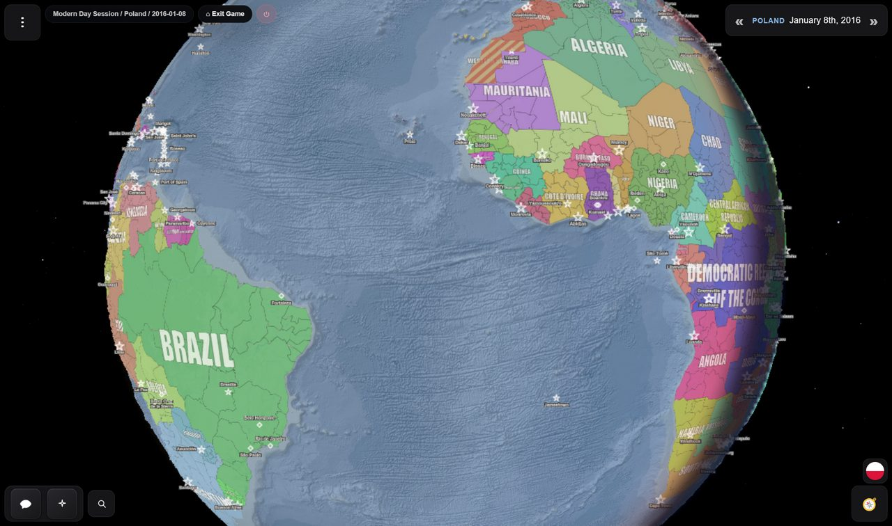

The map is the game's main display and its main control. Everything on it is clickable, and the
way it is coloured tells you who holds what.

## Political fills

Each country is drawn as **one surface** in the colour of whoever administers it, with its
frontiers stitched between neighbours, rather than as a patchwork of separately filled regions.
The fill strengthens as you zoom in — about 46% with the whole world in view, 72% at regional zoom
and 84% close in — so relief and seas read from far out and ownership reads clearly up close.

A campaign opens under a loading screen, the logo turning over a dark ground, while the map works
out every country's surface. That pause is normal, not a hang; the map is revealed once it is
drawn. Switching the 3D globe on or off shows the same screen while the map redraws.

Colours are resolved in a fixed order: the scenario's own palette first, then any colour set on
the country, then a match against known aliases, and finally a colour derived from the country's
name. That last fallback is why an invented faction always gets *a* colour even if you never
picked one — and why two countries occasionally land on similar shades.

*The globe, with the real day/night terminator falling across the Atlantic and the starfield behind it.*

## Striped regions mean a dispute

A region rendered in **stripes** is claimed by more than one country. The stripes combine the
colour of whoever actually administers it with the colours of the claimants.

This is a real mechanic, not decoration — see [territory](/wiki/territory/) for the difference
between holding ground and being acknowledged as its owner.

## Groups' areas

Not everything that holds ground is a country. A **group** — a cartel, a militia, a movement, an
outbreak — can control an area without owning it. Its area is drawn over the countries' colours
with a light tint in the group's colour, an outline around the whole area and the group's name;
the regions in it stay their countries', and nothing about it is a border. Click a region inside
one and its card shows **Group control**, with the group's name and what it is. The story creates,
moves and ends groups as it goes. On beta a scenario or a game can switch groups off, and then no
area is drawn.

## Map modes

<b>Beta channel only.</b>

On beta the map has two modes, switched at the bottom right under the advisor's button or in
**Settings → Map → Map mode**:

- **Political** — every country in its own colour, as described above.
- **Diplomatic** — every country, and the ground taken on a battlefield, in the colour of where it
  stands with you. A legend beside the switch says what each colour means: **You**,
  **Puppets**, **Allies**, **Friendly / Trade**, **Hostile**, **At War** and **Neutral**.

Each time the game opens, the map starts on Political.

## War on the map

<b>Beta channel only.</b>

On beta, where a land war is fought on a battlefield, the battlefield is drawn over the map: the
ground each side has taken, painted in the colour of whose troops took it; the troops as counters
where they stand; and behind them arrows along the way they have come. The front is where the
colours meet. Aircraft circle over battlefields that have them, a battle at sea is marked where it
was fought with a ring and a cross, a blockading fleet has a dashed ring round the water it closes,
and a missile or bombing raid an event tells of is flown across the map when it happens. See
[the War Room](/wiki/war-room/) and [war at sea](/wiki/war-at-sea/).

## Labels

Each country gets **one label**: curved along its territory where it fits, a straight one where
it does not, placed so compact countries read horizontally and long ones follow their length.
Detached land of consequence — Alaska, Kalimantan, Greenland — carries its owner's name as well.
Labels use the name the scenario gives the country, so a renamed country is labelled by its new
name. They scale with the map and fade out by zoom 7.5, once the provinces read on their own (on
beta they begin to fade at zoom 5 and are gone by 6.2). Cities appear from about zoom 3.4 and get
more numerous as you go in.

Scenario authors can set the label font, letter colour and border colour for their world, so a
custom map may look quite different from Modern Day.

You can turn country labels off (**Hide country labels**), or override the label font, in
**Settings → Map**.

## Zoom and bounds

The camera runs from zoom **2.25** (the whole world) to **16** (street level, where the basemap
supports it). Vertical panning is bounded at roughly 80°S to 85°N — there is no reason to fly off
the top of the map.

<b>On beta the camera also turns and tilts</b>, all the way round and up to
60° from looking straight down, on the flat map and the globe alike. The controls are in
<a href="/wiki/interface/">the interface</a>.

## Basemaps

The imagery under the political fills. **Settings → Map → Basemap** starts on **Scenario
default** — whatever the scenario's author chose, which for Modern Day is Ocean — and offers
fourteen others:

| | |
| --- | --- |
| Atlas Relief | Bathymetry and shaded land relief, graded as a political canvas |
| Atlas Relief - Dark | The same, darker |
| Satellite | Photographic imagery |
| Streets | Roads and place names |
| Topographic | Contours and relief |
| Terrain | Physical terrain base |
| Shaded Relief | Hillshading only |
| Physical | Natural-earth style |
| National Geographic | Atlas styling |
| National Geographic - Dark | Atlas styling, darkened, without political or place labels |
| Ocean | Bathymetry and a muted land base |
| Ocean - Dark | The same, darker |
| Light Gray Canvas | Minimal, light |
| Dark Gray Canvas | Minimal, dark |

Your choice is stored per browser and overrides the scenario's; it applies immediately. Setting
it back to Scenario default hands control back to the scenario. A scenario drawn on a map of its
own — a picture, a drawn map, the plain sea of a flat sheet — keeps it: there the list is greyed
out and says so.

Not every basemap has imagery at every zoom — Physical stops at zoom 8, Terrain and Shaded Relief
at 13. Past that the game upscales the last available tiles rather than showing nothing.

<b>On beta the list is the scenario's maps.</b> In a game, <b>Basemap</b>
offers its scenario's starting map, any maps of its own, and the built-in ones it allows — every
one on a real-world scenario, none on an invented one — and your pick is kept for that game only.
The main menu's Settings has <b>Use my default basemap</b>, a built-in map every game starts on
wherever its scenario offers it. Beta also has a fifteenth built-in map, <b>Midnight Terrain</b>, a
very dark physical canvas with no names on it.

## The 3D globe

**Settings → Map → 3D Globe** swaps the flat projection for a sphere.

It is not just a projection change. The globe carries a real day/night terminator computed from
the actual subsolar point, a starfield, and a sun sprite — the lighting corresponds to the real
world clock, refreshed every minute. Left alone, the globe rotates slowly, a full turn every ten
minutes.

Both the idle rotation and the general motion can be switched off — **Disable idle globe
rotation**, or **Reduce motion** as an umbrella setting.

A scenario whose map is a flat sheet rather than a world can switch the globe off for its map;
the switch then says *The 3D globe is disabled for this scenario's map.*

## 3D terrain

**Settings → Map → 3D Terrain**, marked experimental and honestly so. It raises real elevation
with a 7.5× exaggeration so that mountain ranges actually read at world scale, plus light
hillshading. A scenario with a custom background has no elevation data to raise, so it stays off
there.

## Custom backgrounds

A scenario can replace Earth entirely, either with an image pinned to a geographic extent or
with its own vector artwork. This is how fantasy maps work: the political layer sits on top of a
world that has nothing to do with this planet.

A scenario's map can also keep the **projection** it was drawn in — Mercator, Equirectangular,
Miller, Gall-Peters, Robinson, Natural Earth, Equal Earth, Mollweide, Sinusoidal, or **Freeform**,
a flat sheet of any shape — so a flat map or an invented world arrives undistorted. Its author can
also stop the map repeating sideways as you pan past its edge. Projections are set in the
[map editor](/wiki/editor/).

<b>On beta a scenario can have detailed maps.</b> These are large terrain
maps that stay sharp however far you zoom in, drawn over the scenario's own map in the desktop app.
Each downloads once, is checked, and is shared by every scenario that uses it; on the website, on
Android, or without the download, you see the drawn map underneath. In a game,
<b>Settings → Map</b> lists the scenario's maps by name, and under <b>Detailed maps</b> a line says
which are missing or out of date, with <b>Download…</b> beside it.

## Seasons and weather

<b>Beta channel only.</b>

On beta the world has climates. The whole map is faintly tinted by the season each place is in on
the game's date — winter a cold blue-white, spring green, summer a warm yellow, autumn amber —
following climate zones drawn across the world: the real world's on the built-in maps, or a
scenario's own.

Each zone has one weather at a time — clear, rain, storm, mud, snow, blizzard, frost, heat or
fog — drawn over the land as a patch in the zone's own shape, thinning at its edges into the zones
beside it. Clear skies are the commonest weather nearly everywhere. Nothing is written on the map:
ask your advisor for the season and the weather. Lakes and seas frozen hard enough for troops to
cross are drawn as cracked ice, whatever the switches below say, since they change where armies
can go.

In **Settings → Map**, **Seasons and weather** (on by default) turns the tint and the weather on
or off, and **Weather effects** under it the weather alone. A scenario can also fight its wars
without weather, and then none is drawn. What the weather does to armies is on the
[War Room](/wiki/war-room/) page.

## Clicking things

| Click | You get |
| --- | --- |
| **A region** | A card naming the country and the region, with **💬** to open a chat, **⧉** to copy the name and **ⓘ** to open the country's panel. An occupied or contested region also shows who is sovereign, who controls it and who claims it, and a region in a group's area names the group. |
| **A country's panel** | Flag, details, alternative names, related events filtered by importance, and an AI report on request. |
| **A unit** | An intelligence card — what the formation is, whose, how strong, what it appears to be doing. Not a command panel. |
| **A city or structure** | Name, population, whether it is a capital, and what kind of thing it is. |

## Performance

If the map is slow:

- **Turn off 3D terrain.** It is the most expensive thing on the list by a wide margin.
- **Turn off the globe.** The flat map is cheaper.
- **Reduce motion**, which quiets several animations at once.
- Zoom out. Fewer tiles, fewer labels.

The map caches a bounded number of tiles deliberately, to avoid running a browser tab out of
memory on a long campaign.

<b>On beta, Settings → Map has Performance mode.</b> <b>Auto</b> picks
<b>Low memory</b> in the Android app, on a touch screen with no mouse, and on a device with 4 GB of
memory or less: the map then loads in smaller steps with fewer workers. <b>Full</b> is faster on a
strong tablet, and Low memory can steady a weak computer. A change applies after the game is
reloaded.

## Next

- [Territory](/wiki/territory/) — what the stripes actually mean.
- [Cities and structures](/wiki/cities/) — the things drawn on top.
- [Settings](/wiki/settings/) — every map option in one place.
