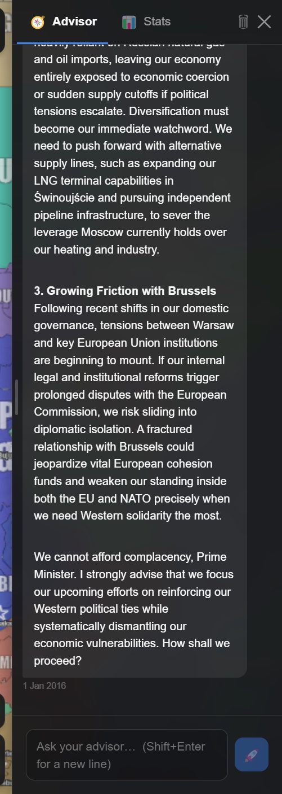
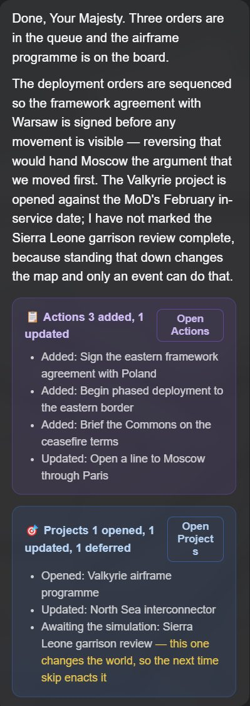

The advisor is an analyst that can see your actual game state. Ask it anything about your
position and it answers about *your* position, not about grand strategy in general.

Open it with the **Advisor** button in the bottom-right corner. Drag the drawer's left edge to resize it; the
width is remembered.

## What it is good for

*The advisor reads the real game state — here, Poland's energy exposure and its friction with Brussels.*

**Orientation.** The fastest way to understand a country you have just picked up:

> What are the three biggest risks to Poland right now?

**Interpretation.** You can read your own stat sheet, but the advisor can tell you what the
combination means:

> My food autonomy is 32 and my debt is rising. How exposed does that make me if the Black Sea
> corridor closes?

**Assessment of other people.** It reads the whole world, not just you:

> Who is most likely to move against me in the next year, and what would the first sign be?

**Deciding what to order.** It is genuinely good at turning a vague worry into a specific
policy, which is exactly the gap that makes [orders](/wiki/orders/) work or not.

> I want to reduce my dependence on Russian gas without wrecking industry. What are my options
> over the next two years?

**Brainstorm** in the Actions panel opens the advisor with a question already in its box — a plan
of concrete actions for this round — for you to send as it is or change first.

## Charts

The advisor answers in markdown, and it can include **charts**. When a question is better
answered with a picture — a trend, a comparison across countries, a breakdown — it renders one
inline rather than listing numbers.

You can ask for one directly: *"chart my GDP growth against my neighbours'"*.

## What it is not

**It is not an oracle.** It reasons from the same world state you can see. It does not know what
other countries have secretly decided, and it cannot see through your opponents' intentions any
better than the information available to you allows.

**It is not privileged intelligence.** For what other countries are actually saying in private,
you need [espionage](/wiki/espionage/). The advisor works from the public picture, your own
records, and the documents your government holds — it knows everything you know and nothing
more.

**It does not act on the world.** Nothing the advisor says moves a border, signs a treaty or
resolves a war until a time skip does it. It *can* write to your order queue and your projects
board on your behalf — see [asking it to do the paperwork](#asking-it-to-do-the-paperwork)
below — but even then it is filling in your plans, not executing them.

**It is only as good as your model.** The advisor is one of the most reasoning-heavy things in
the game. On a small local model its answers get noticeably thinner. See
[AI providers and models](/wiki/ai-providers/).

## Asking it to do the paperwork

The advisor can write straight into your **order queue** and your **projects board**. Ask it in plain language:

> *"Draft me the orders for a phased withdrawal from the eastern border."*
>
> *"Open a project for the rail modernisation we discussed, and close the one on port
> dredging — that finished last year."*

Its reply arrives as normal, and underneath it you get a receipt card for each thing it touched:
a **📋 Actions** card and a **🎯 Projects** card, each listing exactly what changed, with
**Open Actions** or **Open Projects** to take you to the panel itself.

*Three orders queued, one rewritten, a project opened and another updated — each card lists
exactly what changed and links to the panel. The amber line is the one thing it would not do
itself.*

A few things worth knowing about how this behaves:

- **It applies immediately.** There is no confirm step. The card is a receipt of what already
  happened, not a proposal waiting for your approval.
- **Orders are queued, not executed.** Anything it adds lands in the queue as **planned**,
  exactly like an order you typed yourself, and waits for the next time skip. You can edit or
  delete it first. See [giving orders](/wiki/orders/).
- **It can remove and rewrite, not just add.** The Actions card says what it *added*, *updated*
  or *removed*, and the Projects card what it *opened*, *updated*, *completed* or *closed*, so you
  can see which it did.
- **It cannot itself finish a project that would change the world.** Completing something that
  moves a border or renames a country is the simulation's job. The card says so —
  *"Awaiting the simulation … this one changes the world, so the next time skip enacts it"* —
  rather than quietly doing nothing or claiming it finished.

It can also draft for you:

- **Letters.** A reply can carry a draft to a foreign government; **✉️ Draft to France** puts it
  in that country's thread, ready for you to read and send.
- **Deployments.** A recommended deployment comes with **📍 Place … here**, which places it on
  the map with one click — an intention, like any order, until the next skip.

The habit that makes this useful is treating it as dictation. Talk through the situation, then
ask it to write up what you both concluded — and read the cards before you skip.

## It keeps up with the world

**It knows what changed.** When you come back to the advisor after the world has moved on, your
next question carries a short note of what happened since — the newest events, anything in its
own last reply that did not take (a chart it could not draw, a change that only half went
through), and any changes made from the cheats panel — so it does not answer as though it were
still last month. Your message shows it as one small line, *"⏳ Since 1 December 2015 · 3
events"*. Until the event reveal reaches an event, the advisor does not know of it either.

**It knows your standing goal.** Set one in the Actions panel and the advisor weighs its advice by
it, and says plainly when an order works against it.

**Papers arrive here.** When a document reaches your government — a letter through diplomacy, a
copy an agent stole, a secret annex on an event — a line appears in the advisor's conversation:
*📄 A new paper on your desk*, with **Read it** and **Put it away**. It is a notice, not a message
to the model, and an undone turn takes it back.

**A failed answer can be retried.** It shows the provider's error, a button to save the logging
file, and **Retry**, which asks the same question again. See
[troubleshooting](/wiki/troubleshooting/#the-advisor).

<b>On beta the advisor reads your stat sheet and the world's ledgers</b> —
wars, relations, agreements — so it answers from your actual figures rather than estimating them.
It also knows the season and the weather where you are, which of your regions you own, hold or
only claim, who directs whom as far as your own government knows, and your institutions and the
business before them.

## Institutions and groups

<b>Beta channel only.</b>

**Institutional business.** On beta the advisor can prepare a step in one of your
[institutions](/wiki/diplomacy/#institutions) — table a proposal, open a formal vote, cast your
ballot, invite a government — as a **🏛️** button under its reply, such as **🏛️ Vote YES in** an
institution. Nothing happens until you press it, and the step is checked against the institution's
rules at that moment. A letter it drafts can be addressed to an institution's council, too.

**Groups.** In a game with groups — a cartel, a militia, an outbreak holding ground inside a
country — the advisor knows them by name. With **AI lookup functions** on and **Save AI requests**
off (Settings → AI), it looks them up when the conversation turns to them: who they are, and every
region each one controls. Each round of lookups is another request, and it takes at most two before
it answers. Otherwise it is simply handed the list of groups with every message, and asks nothing.

## Clearing it

The **🗑** button clears the conversation. Worth doing when you move into a genuinely new phase
of a campaign and the old thread is no longer the context you want. On a touch screen the first
tap only asks — **Clear?** — and a second clears it.

## Where it sits

The advisor drawer shares its space with the **Stats** tab — the numbers on one side, someone to
interpret them on the other. See [national statistics](/wiki/statistics/).

<b>On beta the advisor has the drawer to itself.</b> The stat sheet moved to a
drawer of its own, the country panel — <i>Politics, diplomacy and national statistics</i> — which
your flag opens, or on a phone your country's name over the date. A map card's Stats button opens
it on that country.

## Next

- [National statistics](/wiki/statistics/) — the sheet the advisor is reading.
- [Giving orders](/wiki/orders/) — acting on the advice.
- [AI providers and models](/wiki/ai-providers/) — what governs answer quality.
