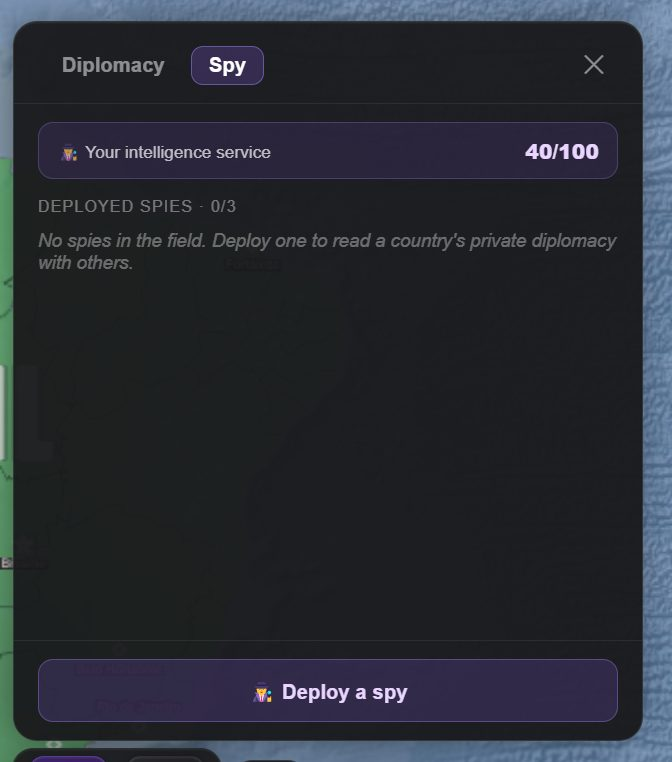
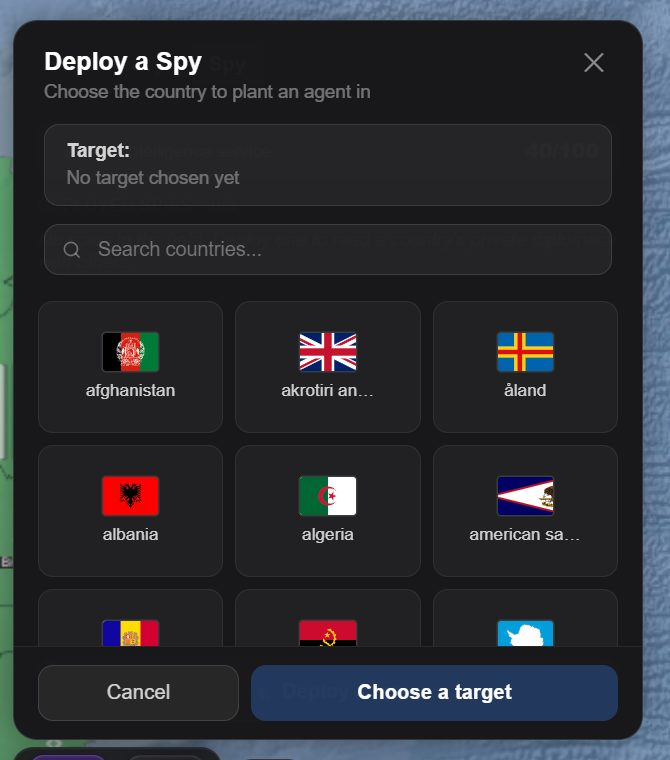
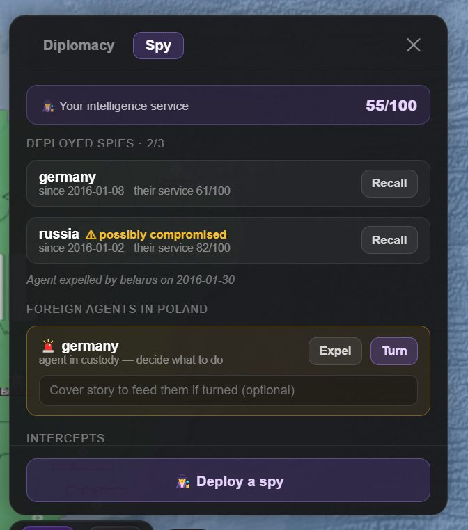
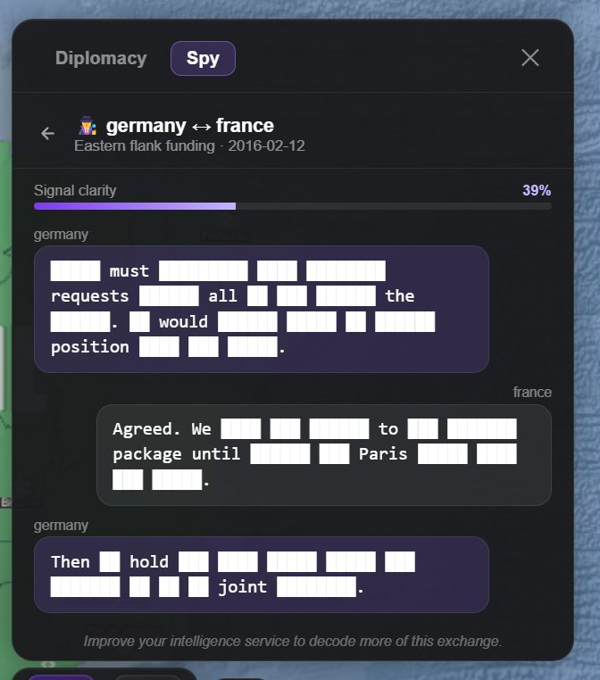

Espionage runs in both directions. You plant agents in other countries and read their private
diplomacy; other countries plant agents in you and read yours. It is the most mechanically
explicit system in the game — the rolls are real numbers, and they are deterministic.

Find it in the **Chat** panel, **Spy** tab. (A scenario can switch espionage off with its
**Espionage** feature; then the Spy tab is hidden and no service acts.)

<p class="beta-note"><b>On beta the tab is called Intelligence</b>, beside Contacts and
Institutions, and it has four sections. <b>Overview</b> rates your service in a word, counts your
active networks, current reports and counterintelligence alerts, and lists strategic warnings and
the latest intelligence. <b>Countries</b> keeps a dossier on every country: how strong your
network, political, diplomatic and source picture of it is, its public political picture, its
institutional position and your intelligence assessment. <b>Operations</b> holds your networks and
their orders, the Operations log, the foreign agents you have caught, and <b>♟ Deploy a
network</b>. <b>Reports</b> files political assessments, intercepted traffic and documents. An
agent is called a network there; it is the same thing.</p>


*The Spy tab before anything is deployed — your service rating, and the three slots you have to spend.*

## Intelligence rating

Every country has an intelligence rating from **0 to 100**. It is the single number that decides
how good its service is at everything below: planting agents, catching yours, turning the ones
it catches, noticing when its own have been turned, and reading intercepted traffic.

The default is **40** — deliberately "ordinary", not "none". A country with no rating yet gets
one assessed the first time it matters: when you open its stats, send an agent there, read an
intercept from it, or catch one of its agents.

Your own rating is on your stat sheet: the **Stats** tab of the advisor drawer, or on beta the
country panel your flag opens. Raising it is a matter of governing that way — order intelligence
expansion, fund the service, make it a priority — and it moves like any other national statistic.

<p class="beta-note"><b>On beta the Intelligence tab puts your service in a word</b>: Minimal
below 30, Developing from 30, Limited from 50, Capable from 70 and Advanced from 85.</p>

## Limits

| | |
| --- | --- |
| Agents you can have active | **3** |
| Foreign agents inside you at once | **3** |
| Agents per target country | **1** |
| Spying on yourself | Not possible |

Three is not many. Choosing where those three go is most of the strategy.

## Sending an agent

From the **Spy** tab, deploy to a target country. You can also just write it as an order —
*"deploy a spy in Germany"* — and the next time skip places a real agent through exactly the same
rules and caps, quietly on the turn it happens; an order can also give the officer a cover, who
they pose as. Either way the agent's operation opens on your
[Projects board](/wiki/projects/) the same turn, and recalling or losing it closes it.

An active agent reports: it feeds you the target's private diplomatic traffic, subject to how
much of it you can actually read.


*The target picker. Countries you already have an agent in are not offered again — one agent per
country, and never yourself.*

You can **recall** an agent at any time, and see everything it has sent.

<p class="beta-note"><b>On beta you deploy from the Operations section</b>, with <b>♟ Deploy a
network</b>. Each network there says how well it reads its target — Strong, Moderate or Limited —
with <b>Dossier</b> and <b>Recall</b> beside it, and takes orders: see
<a href="#orders-and-operations">orders and operations</a> below.</p>


*Every state at once: an agent running in Germany, one flagged **possibly compromised**, a line
recording one Belarus expelled, and a German agent caught inside Poland waiting on your decision —
expel it, or turn it and write what it reports home.*

## Getting caught

Every jump, each of your agents is rolled against the target's service.

The chance of detection is driven mostly by the **gap** between the two services:

```
detection = 0.04 + (target/100 − yours/100) × 0.25 + (target/100) × 0.10
            clamped to between 2% and 60%
```

Read that as: a service much better than yours will find your agent quickly; a service much
worse will mostly not. But there is a floor of 2% — a brilliant agent in an incompetent country
is never perfectly safe — and a ceiling of 60%, so even a hopeless agent is not guaranteed to be
caught on day one.

Some worked numbers, per jump:

| Your service | Their service | Chance your agent is caught |
| --- | --- | --- |
| 40 | 40 | 8% |
| 40 | 80 | 22% |
| 80 | 20 | 2% (the floor) |

<p class="beta-note"><b>On beta, sources and operations change the roll.</b> Each recruited source
a network runs cuts this chance by a tenth, and a network that carries out an operation during a
skip is not rolled that skip: the operation's own risk of capture decides it.</p>

## Caught, then what

A caught agent becomes **discovered** and stops reporting. The target then either **turns** it
or **expels** it:

```
turn chance = (target intelligence / 100) × 0.6
              clamped to between 5% and 60%
```

Turning takes skill. An ordinary service mostly just throws your agent out; a very good one
keeps it.

### Who sent them

<p class="beta-note"><b>Beta channel only.</b></p>

On beta, a caught agent is not always made to say who sent it. The service that caught it learns
whose agent it is with this chance:

```
identified = 0.6 + (catcher/100 − sender/100) × 0.5
             clamped to between 20% and 90%
```

An identified agent goes on as above: turned or expelled. One that is not identified dies under
interrogation, and the trail ends there — the country that caught it never learns who sent it.
Your **Operations** section keeps a line for it, *caught, and died in custody without giving you
away*, and its entry on the Projects board fails with a note that the agent has gone silent.

### The turned agent

This is the part worth understanding properly.

**You are never told that your agent has been turned.** From your side it looks like it is still
reporting. What it is actually sending is material the target wrote for you.

Each jump, your own service gets a chance to notice:

```
suspicion = 0.05 + (yours/100 − target/100) × 0.3
            clamped to between 2% and 50%
```

So a service better than the one that turned your agent will usually spot it eventually. A
service much worse may never.

The game itself always knows — reports produced while an agent was turned are permanently marked
as planted — but that mark is not shown to you. It exists so that the consequences are consistent
later.

The practical lesson: **intelligence you cannot corroborate is not intelligence.** If a single
agent is telling you something convenient, and your service is weaker than theirs, consider that
you may be reading fiction written for you.

## Being spied on

Other countries plant agents in you, on their own initiative, every jump:

```
deploy chance = (their intelligence / 100) × 0.12 + hostility × 0.2
                capped at 40%
```

A capable service does it as a matter of course. A hostile one goes looking. At most three
foreign agents can be inside you at once.

When you catch one, it appears in the Spy tab and **waits for your decision**:

- **Expel** it. Clean, final, and it tells the other country you found them.
- **Turn** it. It becomes a double agent, and from then on *you* write what it reports home.
  The country that sent it is not told.

Turning is the more interesting option and the more useful one, but it requires you to keep
feeding it plausible material.

Typing a story before you turn the agent changes the button to **Turn & plant story**, so the
first report home is yours from the start. A turned agent's **Save** is greyed out while the field
matches what it already reports and reads "Saved" for a moment after you save; Enter in the field
saves too.

<p class="beta-note"><b>On beta, your service has to identify them too.</b> A foreign agent you
catch is identified by the same chance as under <a href="#who-sent-them">Who sent them</a>, with
your service as the catcher. One that is never identified dies under interrogation: there is no
one to expel or turn, and the Operations section notes only that a foreign agent died and who sent
them was never learned. When your service does learn who sent one, it waits under
<b>Counterintelligence cases</b> in the Operations section, and you decide as before.</p>

## Reading intercepts

You rarely get a clean transcript. How much of an intercepted message you can read depends on
both services:

```
clarity = 0.12 + (yours/100) × 0.88 − (theirs/100) × 0.35
          clamped to between 6% and 100%
```


*An intercept read at 39% clarity. The formula above gives exactly that for a service of 55
reading one of 61: `0.12 + 0.55×0.88 − 0.61×0.35`. Punctuation survives; the words do not.*

Unreadable words are blanked out, but punctuation and sentence rhythm survive, so you can often
tell the shape of what was said even when you cannot read it. Raising your intelligence rating
only ever reveals *more* of a message you have already seen — it never re-hides anything.

| Your service | Their service | How much you can read |
| --- | --- | --- |
| 40 | 40 | 33% |
| 80 | 40 | 68% |
| 20 | 80 | 6% (the floor — essentially nothing) |

Intercepts are stored separately from the rest of your save and **encrypted at rest** with a key
unique to your campaign. They are decrypted only to show you and to inform the simulation. An
undone turn, or an Intervene, takes the turn's reports back with it.

### Clarity on beta

<p class="beta-note"><b>Beta channel only.</b></p>

On beta how much you can read rests on your own service, on a steep curve, and the target's
service resists it only lightly:

```
clarity = 0.07 + (yours/100)^1.6 × 0.92 − (theirs/100) × 0.10
          never below 4%
```

A world-class service reads nearly every word; a weak one gets scraps. The intercept pictured
above would read at 36%.

| Your service | Their service | Stable build | Beta |
| --- | --- | --- | --- |
| 40 | 40 | 33% | 24% |
| 60 | 40 | 51% | 44% |
| 80 | 40 | 68% | 67% |
| 100 | 40 | 86% | 95% |
| 100 | 100 | 65% | 89% |
| 20 | 80 | 6% | 6% |

A network reads as **Strong** from 72% clarity, **Moderate** from 46% and **Limited** below that.

## Stolen documents

Some things governments know are not on the public record at all — a secret protocol, a private
letter between heads of state, the full articles of a treaty. When such a document is held by a
government where you have an **active** agent, your agent brings you a copy: it is filed in the
Spy tab with the agent's intercepts, sealed like them, and readable only as far as your service
can read theirs. A turned agent brings nothing real. The country you stole it from is never told.

<p class="beta-note"><b>On beta every paper your government holds is in one place</b>: the
Intelligence tab's Reports section lists them under <b>Documents on file</b>, a stolen one marked
as an intercepted copy, and opens each one's text there.</p>

<p class="beta-note"><b>On beta, agents can uncover covert puppets.</b> An active agent inside
either party to a covert <a href="/wiki/war/#puppets-and-overlords">puppet arrangement</a> reveals
it at the end of the turn, and keeps what you know of it current for as long as it stays in
place.</p>

## Agents report in real time

Agents report after time skips — their reports come back in the skip's own answer, at no extra
request, and each agent files at least every third skip. They also report between
skips: while the game is open and on screen, each deployed agent is rolled roughly once a minute,
working out to about **one report every twenty minutes per agent**. Those in-between reports are
background AI, so they only happen while **Background AI** is on, and stop at its daily cap.

This is deliberate and it is why there is no "gather intelligence" button: an agent is a trickle
of information you receive over time, not a resource to farm on demand. Leaving the game open
during a tense period genuinely gets you more.

## Agents at war

<p class="beta-note"><b>Beta channel only.</b></p>

On beta, an agent of yours inside a country on the other side of a battlefield sends you its
staff's planned movements: the War Room lists them, *From your agent in* that country. A turned
agent sends what it is fed — the other side's diversions, or plans made up for it — and nothing in
what arrives says which.

It cuts both ways. An agent of theirs you have not caught sends them your real plans, and the
diversions you draw in the War Room reach them only through an agent of theirs you have turned.

## Orders and operations

<p class="beta-note"><b>Beta channel only.</b></p>

On beta your agents take orders. Every network in the **Operations** section carries two: what it
collects on, and one operation for the next time skip.

### What a network collects on

**Collect on** sets where a network looks: **Diplomacy** (the default, and the private traffic
described above), **Military**, **Research and technology**, **Economic policy** or **Internal
politics**. Most of each report then bears on it: the intercepted exchanges wherever they touch
that subject, and the findings of any political assessment that comes with them, filed under
Reports. Change it whenever you like; the next report follows it.

### Ordering an operation

Choose **Sabotage**, **Recruit**, **Assassinate** or **Other operation**, say in a line what the
agent should do — what to sabotage, whom to recruit, who the target is — and press **Give the
order**. Under the field the network shows its **Odds of success** (Good, Even, Poor or Slim) and
its **Risk of capture** (Low, Moderate or High) before you commit. A network holds one order at a
time. It waits, marked *Carried out during the next time skip*, and **Cancel order** withdraws it
until then.

The odds come from the two services and the network's recruited sources:

```
success = base + (yours/100 − theirs/100) × 0.6 + sources × 0.05
          clamped to between 5% and 90%

capture = detection × risk − sources × 0.03, plus 0.15 if it failed
          clamped to between 4% and 85%
```

Here *detection* is the per-jump chance from [Getting caught](#getting-caught), and each kind of
operation has its own base and risk:

| Operation | Base | Risk |
| --- | --- | --- |
| Sabotage | 50% | × 2.2 |
| Recruit | 45% | × 1.6 |
| Assassinate | 30% | × 3 |
| Other operation | 50% | × 1.8 |

Success reads **Good** from 70%, **Even** from 45%, **Poor** from 25% and **Slim** below; capture
reads **High** from 45%, **Moderate** from 20% and **Low** below. The risk shown is the risk if the
operation succeeds — a failed one is 15 points likelier to be caught. With your service and theirs
both at 40 and no sources: sabotage is Even (50%) at Low risk (18%, or 33% if it fails), a
recruitment Even (45%) at Low risk (13%), and an assassination Poor (30%) at Moderate risk (24%).
A caught agent is then identified 60% of the time.

### What the world sees

The operation is carried out during the next time skip. The game decides how it went before the
skip is written, and the skip is told only the result:

- **Succeeded and never traced.** The skip writes the event it makes — the fire at the shipyard,
  the death, the defection — with its consequences, and nobody in the world, the target included,
  knows who was behind it, then or later. The skip is not even told that you have an agent there.
- **Failed and nobody noticed.** Nothing happens.
- **Caught, and never identified.** The arrest and the agent's death in custody make an event, with
  no culprit named. Your network is lost.
- **Caught and identified.** The arrest makes an event naming you, and the story goes on from there
  between you and the target. Your agent is expelled.

A recruitment that succeeds untraced makes no public event at all: the person simply works for you
from then on.

A network that was turned without your knowing never carries an order out. The target knows you
gave it; the Operations log says only that the agent reports it could not be done.

### Recruited sources

A successful, untraced recruitment adds the person you named to the network as a **recruited
source**, listed under it. A network runs up to three; a fourth replaces the oldest. Each source:

- cuts the network's chance of being caught on an ordinary jump by a tenth;
- adds 5 points to the success of its operations and takes 3 off their risk of capture;
- feeds its reports: at least one finding in each comes from a source, and says what that source
  could know.

### The Operations log

Under your networks, the **Operations log** shows the eight most recent operations, newest first:
the kind and the target, what you ordered, the date and what it came to — *Succeeded, and was
never traced*, *Failed, and nobody noticed*, *Succeeded, but the agent was caught and died in
custody without giving you away*, and so on. Above it is a line for each of your last three agents
expelled or lost.

### Using them well

- **Recruit before you strike.** Sources make every later operation likelier and safer, and keep
  the network itself alive longer.
- **An assassination is the loudest order you can give.** It has the lowest odds and triples the
  network's ordinary chance of being caught; give it with a strong service, against a weaker one.
- **Untraced is the point.** An operation that is never traced is never tied to you; one that is
  traced and identified is an incident with your name on it.

## Playing it well

- **Raise the rating before you rely on the service.** At 40 you can barely read what you steal
  and you are caught reasonably often. Intelligence capability is worth ordering as a programme.
- **Three agents means three priorities.** Put them where a surprise would actually hurt you.
- **Recall an agent that has done its job.** Every jump it stays is another detection roll.
- **Turn the agents you catch** rather than expelling them, if you can afford the attention.
- **Distrust a lone source**, especially against a stronger service.

## Next

- [Diplomacy](/wiki/diplomacy/) — the conversations your agents are reading.
- [National statistics](/wiki/statistics/) — where the intelligence rating lives.
- [Projects and operations](/wiki/projects/) — running covert work as a long programme.
