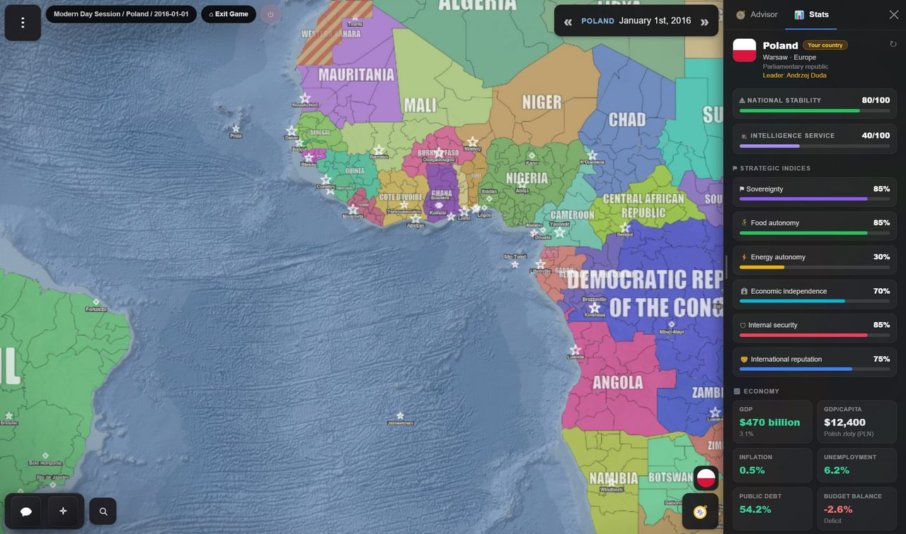
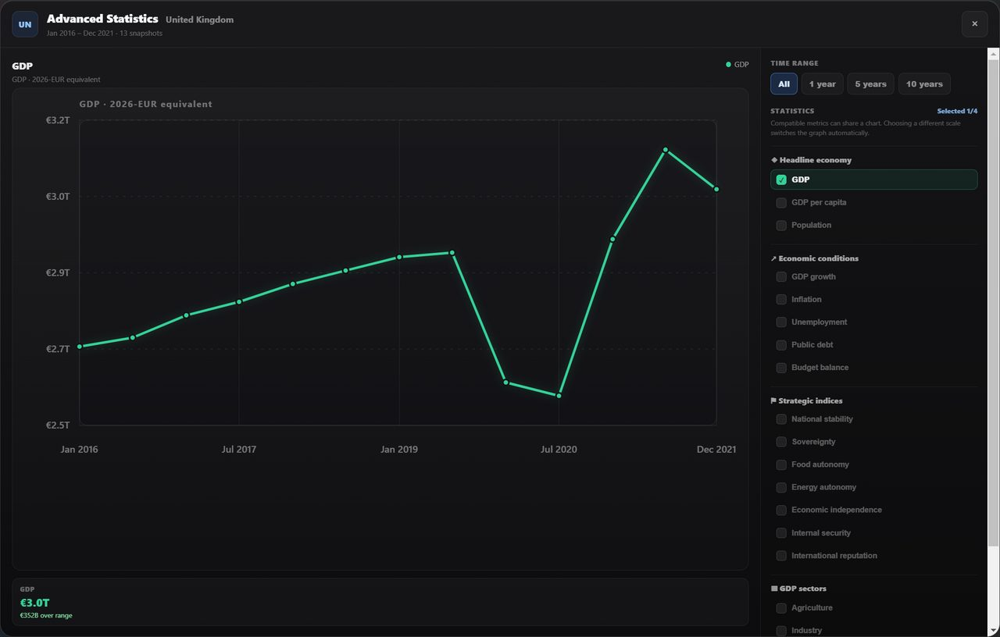
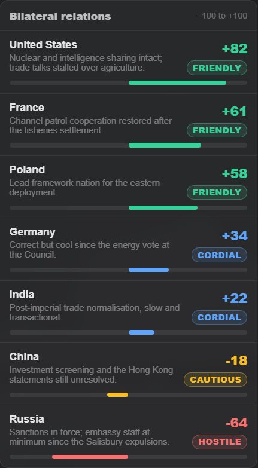
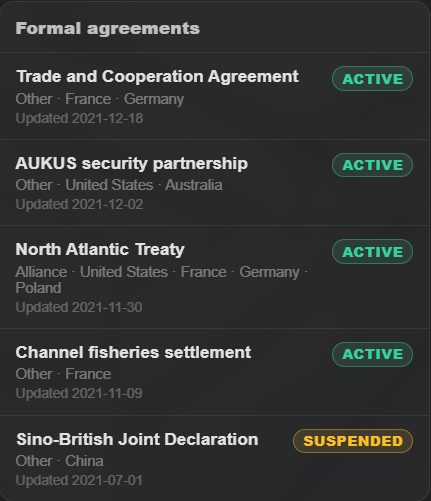

Every country has a **stat sheet** — relations, agreements and conflicts, then leader,
government, stability, six strategic indices, population and a set of economic figures. Open it
from the **Stats** tab of the advisor drawer (the **Advisor** button, bottom right). It has two
tabs, **🤝 Diplomacy** and **📈 Economy**.

It retargets to **whatever country you last clicked on the map**, so it works as a dossier on
anyone, not just yourself.

<b>On beta the sheet has a panel of its own.</b> Stats has left the advisor
drawer. Your flag at the bottom right, above the advisor's button, opens the <b>Country</b> panel
(on a phone, your country's name in the date pill does), and so does <b>Stats</b> on any country's
card. It has four tabs — <b>🏛 Politics</b>, <b>🤝 Diplomacy</b>, <b>📈 Economy</b> and
<b>🏆 Ranking</b> — and opens on Politics. Under the country's name it shows its tags and, once
the game has ranked it, whether it is a <b>Major power</b>, <b>Regional power</b> or <b>Minor
power</b>.

*Poland's sheet. Note the intelligence service at 40 — the default for a country nobody has assessed.*

## National stability

A single 0–100 figure for how firmly the government holds the country together, with a colour
band:

| Stability | |
|---|---|
| 70–100 | Green — solid |
| 40–69 | Amber — strained |
| Below 40 | Red — in trouble |

Stability is the number to watch when you are pushing your own country hard. Wars, austerity,
purges and humiliations all cost it, and a country in the red is one where events start
happening *to* the government rather than because of it.

## Strategic indices

Six measures, each 0–100:

| | Index | What it measures |
|---|---|---|
| ⚑ | **Sovereignty** | How much the country actually decides for itself |
| 🌾 | **Food autonomy** | Whether it can feed itself |
| ⚡ | **Energy autonomy** | Whether it can power itself |
| 🏦 | **Economic independence** | How far it is at the mercy of others economically |
| 🛡 | **Internal security** | Control over its own territory and population |
| 🤝 | **International reputation** | How far it is trusted abroad |

These are the strategic picture in six numbers. A country with high GDP and low food and energy
autonomy is rich and vulnerable; one with high internal security and low sovereignty is a
well-run client state.

**International reputation** is not just a display value — it is a real world field that other
countries respond to. See [countries and identity](/wiki/countries/).

## Intelligence service

A separate 0–100 rating for the country's intelligence apparatus, shown on the same sheet. It is
never written by the model as part of the economic figures. A service nobody has assessed reads
40, an ordinary one; opening a country's **📈 Economy** tab asks for a first reading of it, as
background AI, so only while **Background AI** is on (Settings → AI → AI requests).

After that it moves through events, and every time skip is shown your service's rating so that
it can. The skip is told to raise it a few points at a time for what you ordered and the turn
actually delivered — a training academy opening its doors, a new bureau standing up, a funding
increase taking effect, a codebreaking programme bearing fruit — and to lower it for a purge, a
mass defection, a network rolled up by a rival or deep cuts. An order only just given moves
nothing, and no single measure is meant to jump it by tens of points.

It is the governing statistic for [espionage](/wiki/espionage/), and worth raising deliberately
before you start relying on agents.

## Population and economy

| Field | |
|---|---|
| **Population** | Total population |
| **GDP** | With growth rate shown beneath |
| **GDP per capita** | With the country's currency |
| **Inflation** | |
| **Unemployment** | |
| **Public debt** | |
| **Budget balance** | Surplus or deficit |

Plus a **GDP breakdown** bar splitting output between **agriculture**, **industry** and
**services**, validated to add up to 100.

Large numbers are displayed compactly — 30,000,000,000 shows as 30.0B — with the currency symbol
preserved.

<b>On beta, war moves these figures too.</b> The men a country raises for a
battlefield leave its population and those who come home are given back, so a war costs it the
men who do not; and a blockade takes a share of its GDP and points off its budget balance. See
<a href="/wiki/military/#men-money-and-military-power">men, money and military power</a>.

## Military power

<b>Beta channel only.</b>

Under the economy, the **⚔ Military** card gives the country's **Military power** — what it
weighs in a land war, counted from its people and what its forces have to spend, never from the
land it holds — and the figures that power is read through, each as a bar out of 100:

| Figure | |
|---|---|
| **Troop quality** | How well its soldiers fight |
| **Technology** | What they fight with |
| **Spending** | What its forces have to spend, against other countries' |
| **Manpower share** | The share of its people who can be put under arms, in per cent (12 unless its scenario or the country itself says otherwise) |
| **War weariness** | How weary of war it is, in amber once it is weary at all |
| **War resources** | What it has left to fight with besides its men, where the scenario's wars use them |
| **Land**, **Naval**, **Air** | What it can do on land, at sea and in the air |

A figure in colour is the country's own, from its scenario or its sheet; one in grey is what every
country has, which is 50 on the 0–100 figures. The thin mark on a bar is where every country
stands. A scenario can switch countries' own figures off, and then the card says that every
country fights with the same.

The figures are rated by the AI against every other country's, twenty countries to a request. A
scenario's designer can rate them all at once and ship them with the scenario; a country nobody
rated is rated the first time the game needs it — when its Military card is opened, when the
ranking is by military power, or when it goes to war — as background AI.

**How they move.** Every time skip is shown your figures and those of the countries at war with
you, and told to move them only by what happened. Training and exercises raise troop quality;
modernising, research and new weapons raise technology; a bigger defence budget raises spending;
conscription, mobilisation or a larger standing army raise manpower and land; new warships raise
naval and new aircraft air. Heavy losses, purges, cuts, demobilisation and neglect lower them.
It is told to size each change to what the period delivered: a month a point or two, a year of
real effort several, a decade of determined rearmament twenty or more. An order only just given
moves nothing yet.

What each figure does in a war is on
[men, money and military power](/wiki/military/#men-money-and-military-power).

## There is no treasury

This is the important thing to understand about economics in Open Historia: **the economy is a
description, not a bank account.**

There is no pot of money you spend, no per-turn income to allocate, and no build costs to pay.
GDP, debt and budget balance describe your country's situation and inform how the world treats
your decisions — a country with 140% public debt and a deficit will find an expensive
rearmament programme going badly — but you never "afford" anything by clicking.

You change the economy the way a government does: by ordering policy and living with the
consequences. See [giving orders](/wiki/orders/).

<b>On beta, the economy pays for the war.</b> Still nothing you spend by
hand: what a country's forces have to spend is worked out from its GDP, more with a budget in
surplus and less with a deficit or a heavy debt, and its economy refills the war resources its
fortifications use up, less under a blockade. See
<a href="/wiki/war/">war</a>.

## Where the numbers come from

Stat sheets are generated on demand for the country you are looking at, from the actual world
state, and cached so that reopening the panel does not regenerate them. The **↻** control
refreshes one; **Shift**+click rebuilds its baseline from scratch.

<b>On beta, ↻ opens a choice.</b> <b>Refresh</b> uses a request only if
something has changed since the last assessment (on a scenario's own sheet, always one), and on
the standard sheet <b>Rebuild baseline from scratch</b> uses one request to replace the numbers
with a fresh assessment of the country as it stands, after you confirm it. Only the
<b>📈 Economy</b> tab builds a sheet the moment you open it; <b>🏛 Politics</b> and
<b>🤝 Diplomacy</b> leave a missing one to background AI, and going down the <b>🏆 Ranking</b>
asks for nothing.

On a brand-new game the world is still writing its backstory for the first few moments. Open
Stats then and the sheet waits for it — *"Waiting for the world to finish updating, then
compiling national statistics…"* — rather than running a second AI call alongside it and
describing a world with no history yet.

They then move through events. When a turn changes a country's circumstances, the event carries
the statistical change with it — and only the fields that actually changed, so everything else
keeps its previous value.

That includes **who leads**: a leader overthrown in an event has their successor written to the
sheet in the same breath.

<b>On beta, a scenario can say how many people a country begins with.</b>
In the Workshop's Countries panel, <b>Population when the scenario begins</b> sets the figure its
troops are raised from and its statistics begin from. And every country you come into conflict
with — on a battlefield with you, or in the path of a route you draw — has the figures a war reads
of it (its people, GDP, budget balance and debt) worked out in one request for up to eight
countries at a time, as background AI.

## Reading someone else's

Click any country, open Stats. You get the same sheet for them.

Two caveats. What you see is the world's view of that country, not privileged information — for
that you need [espionage](/wiki/espionage/). And generating a sheet for a country you are
interested in is itself the trigger that gets them an intelligence rating assessed, if they did
not have one.

## The Politics tab

<b>Beta channel only.</b>

**🏛 Politics** is the country's government as the world knows it: its form, its **Head of
state** and **Head of government**, and the party or coalition in power. Beneath that, a ring
shows its **Political landscape**, each party's support, or, where it is not governed through
elections, its **Power structure**, who holds the influence. Clicking a slice opens that party or
bloc: its leader, its public priorities and its foreign-policy outlook. Then its **National priorities**, the
**Institutions** it belongs to, and whatever your agents have reported of its politics.

Where [groups](/wiki/territory/#groups) are on, it also lists the groups holding ground on the
country's territory; a row flies the map to the area it controls.

## The Ranking tab

<b>Beta channel only.</b>

**🏆 Ranking** sets the countries of the game side by side by one figure at a time: **Population**,
**Economy**, **Wealth per person**, **Military power**, **Land held**, **Stability**,
**Reputation**, and **War weariness** once anyone is weary. A scenario with a sheet of its own
ranks by its own values instead, beside military power, land, reputation and weariness.

Each row has the country's rank, flag and figure, with your own country outlined; click a row and
the panel turns to that country. The first 25 are shown, and **Show every country** lists the rest.

A figure that comes from a stat sheet only covers the countries that have one — your own, those
you track, those you have opened, those you came into conflict with. The rest are left out, and
the tab says how many, rather than ranking a guess. Ranking by military power has the AI rate the
countries nobody has rated yet.

## A record, not a snapshot

The sheet can keep a history, so it is a record of the campaign rather than a snapshot. Everything
above is under **📈 Economy**; **🤝 Diplomacy** is below.

### Tracked history

The sheet re-generates itself as the campaign runs, so you can watch a country's debt climb or
its energy autonomy recover across a decade instead of re-reading a number. **Historical
tracking**, at the foot of the Economy tab, sets it up.

| | |
|---|---|
| **Refresh interval** | Manual only, or every **3, 6, 12 or 24 months** of game time |
| **Countries tracked at once** | **8** |
| **History kept** | Up to **1200** samples |

Your own country is always included once an interval is set. Everything else you add yourself
from the tracked-countries list; there is a **✕** on each to stop tracking it again.

<b>On beta, tracking is on from the start.</b> A game tracks your country
every 6 months unless you turn it off, and asks for its first sheet after a time skip if it has
none yet.
<b>Refresh status</b> says when each tracked country was last refreshed, and <b>Assess now</b> builds
the first sheet of one that has none, which the automatic refresh otherwise skips.

### Advanced Statistics

Once there is history to draw, **Advanced statistics** at the foot of the Economy tab opens a
full-screen chart over it. Pick a metric and it plots every snapshot taken, dated in game time:

| Group | Metrics |
|---|---|
| **Headline economy** | GDP · GDP per capita · Population |
| **Economic conditions** | GDP growth · Inflation · Unemployment · Public debt · Budget balance |
| **Strategic indices** | National stability, and all six indices above |
| **GDP sectors** | Agriculture · Industry · Services, as a share of GDP |

A scenario with a sheet of its own charts its own sections and values instead.

*Six years of British GDP, with the 2020 collapse and the rebound. The range buttons narrow it to
the last year, five or ten.*

You can put up to **four** metrics on one chart, as long as they share a scale — tick a metric on
a different scale and the chart switches to it rather than drawing a meaningless second axis. The
range buttons across the top limit it to the last **1, 5 or 10 years** of game time.

Money is charted in a **2026-EUR equivalent** so that countries with different currencies can be
compared on one axis. Ancient scenarios chart correctly too — BC dates run backwards through the
missing year zero, so a campaign starting in 218 BC plots in the right order.

### The diplomacy block

Every sheet carries a **🤝 Diplomacy** section, which is where the
[relation ledgers](/wiki/war/) actually become visible. Three counts across the top — relations,
active agreements, conflicts — and then the detail:

**Bilateral relations.** Every tracked relationship this country has, scored **−100 to +100**,
each with a one-line summary, a meter, and a badge the game derives from the score — friendly,
cordial, neutral, cautious, strained, hostile or rival. This is the single most useful screen in
the game for working out who someone's real friends are before you approach them.

*The United Kingdom's relations, sorted best to worst. The summary line is why the number is
what it is.*

**Formal agreements** and **current conflicts** follow underneath: the treaty register with each
agreement's type, parties, status and the date it last changed, and then who this country is
currently fighting, taken from the war ledger.

*Agreements are listed active first. A suspended treaty stays on the register rather than
disappearing — the relationship still has a history.*

An empty list means no record exists, which is **not** the same as neutrality — a pair of
countries that have never interacted simply has nothing written down yet.

<b>On beta the block says more.</b> A <b>Subordination</b> card says what you
know of a <a href="/wiki/war/#puppets-and-overlords">puppet arrangement</a> the country is part
of, and an overlord's <b>Subordinate states</b> are listed with their kind. Each conflict says who
is fighting alongside, why it began, and links to <b>See how it began on the timeline</b>; it
shows each side's war weariness and, in a war of your own, <b>Propose peace</b>. Below them,
<b>War reports</b> keeps the after-action report of each of your wars fought out on a battlefield,
with <b>Read the report</b>. See <a href="/wiki/war/">war</a>.

### Territory, overseas and landless

**Countries with overseas territories** get a per-capita figure twice: for the core and
integrated territory, and for the **whole polity** including dependencies. The two can differ
sharply, and the sheet shows both rather than picking one.

**Landless polities work.** A government-in-exile, a rebel movement or an organisation with no
mapped territory gets a valid sheet.

**Population follows the land.** When territory changes hands, its people and economy go with
it, so the game keeps track of how much of a country sits in each piece of its territory. For a
country with up to 24 such pieces, the model estimates that split once, from where people
actually live, never from how many map regions or how much area a piece covers. The game checks
the answer and keeps it, asking again only when a piece changes size. Sprawling historical
empires are split by the game's own weights instead. A piece of territory also keeps its own
income level, so Puerto Rico is not credited with mainland American productivity. And a country
holding part of another's land is assessed on **that part only**: Russia holding Crimea is not
handed the whole of Ukraine's population.

## Scenario stat sheets

The standard sheet is written for the modern world. A scenario can replace it entirely: in the
scenario editor's **Stats** tab, under **National Stats**, **Customize full sheet** turns the
standard layout into the scenario's own — sections and statistics you can rename, reorder, delete
or add, each with a type (number, percentage, currency/value), a unit, a range, decimals, an icon,
a colour and a line of **AI guidance** on what the value means in this world and what kinds of
events should move it. A Bronze Age scenario can track grain stores and chariots instead of GDP
and unemployment. The sheet is scenario data, so it travels with exports; **Use standard sheet**
goes back. Its Economy tab is then called **📊 National**.

<b>On beta, a scenario's own sheet keeps a second layer.</b> Under the values
its players see, every country also carries the four figures a war reads — its people, GDP,
budget balance and public debt — written in the same request as the sheet and moved by the same
time skips, so its troops have people to be raised from. Its players never see them. The
intelligence service and the ⚔ Military card show on such a sheet too.

<b>On beta the advisor reads your stat sheet</b> — and the world's war,
relation and treaty ledgers — so it can answer about your figures rather than estimating them.

## Next

- [Countries and identity](/wiki/countries/) — reputation, tags and leaders.
- [The advisor](/wiki/advisor/) — asking someone to interpret all this for you.
- [Espionage](/wiki/espionage/) — the intelligence rating in practice.
- [Military](/wiki/military/) — what the military figures do in a war.

### Sources and estimates

Open **Sources and estimates** below the National/Economy figures to inspect their
origins, including population, economic conditions, strategic indices, sectors,
custom metrics, intelligence and military figures. The section works on phones as
well as desktop. Historical chart details use the source saved with that reading,
not the source of today's value.

| Label | Meaning |
|---|---|
| Scenario value | A recorded starting value carried into a new game from its scenario |
| Manual edit | A value changed through the Country Editor |
| AI estimate | A changed value accepted from an AI assessment, event or GM response |
| Calculated | A figure computed by native game rules, which may themselves use estimates |
| Game default | A shared fallback used because no individual figure has been recorded |
| Source unspecified | A recorded value whose origin was not retained, including older saves |
| Unknown | No numeric observation is available |

These labels identify where the game recorded a number. They do **not** certify
historical accuracy, provide historical citations, or classify an author's number
as a measured fact. The date and turn are the last accepted **value change**, when
the writer supplied that context. An unchanged value keeps its previous source
and date; an unknown date stays omitted.

New games retain origins for recorded scenario starting values. Existing games,
clones and imports keep the origins they already have; opening a legacy save does
not guess its origins. If a value changes through an untracked path, a source bound
to its old number is not shown as the source of the new one. Direct edits to save
files do not constitute a verified audit trail.

Metadata travels with the existing world and history data. Older game versions
can discard it while retaining the numbers. No extra AI requests, economic rules,
or accounting engine are introduced. Full change logs, event links, reviewed
historical citations and author-facing certainty controls remain separate work.
