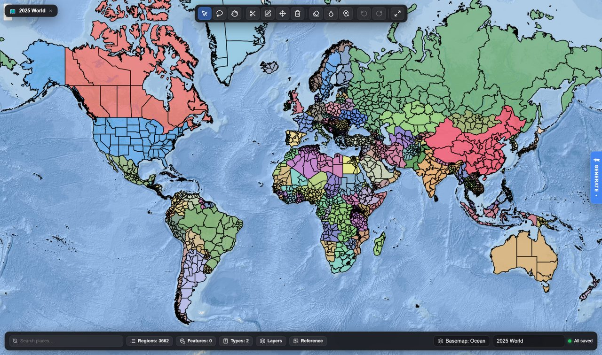

The map editor is a full vector editor for building worlds. Draw regions, assign owners, place
cities, set flags and colours, import a background, and hit **Apply & Play** to start a campaign
on what you made.

Open it from any scenario's editor drawer via **🗺️ Open Map Editor**, or go straight to the
standalone editor at **`/?editor=1`**.

*The standalone editor on its default world. The tools run along the top; the bottom bar opens the panels, each with a count — regions, countries, features, units, region types.*

<b>On beta the editor is laid out anew</b>, in the style of the main menu:
the tools, the panels and the save buttons sit in one sidebar, docked on the right. Its gear
(<b>Settings</b>) moves it to the left — <b>Side: Left / Right</b>, remembered on this device — and
the tab on its edge hides it and brings it back. Its header holds the map's name, the Documents
menu and search; on a phone it is a drawer, opened with the <b>Tools</b> button at the bottom of
the screen beside <b>Undo</b> and <b>Redo</b>.

## The tools

| Tool | |
|---|---|
| **Select** | Pick a region and inspect it. Shift-click adds more; a double-click takes its whole country. |
| **Lasso select** | Drag a circle to select several at once. |
| **Pan** | Move the view. |
| **Draw region** | Trace a new territory. Click along an existing border and it follows it. |
| **Edit vertices** | Reshape selected regions point by point, with snapping and undo. |
| **Shared border precision** | Select exactly two neighbours and drag their shared border; it is welded into both. |
| **Move** | Move a region. |
| **Delete** | Remove a region. |
| **Delete border** | Dissolve the boundary between two regions, merging them. |
| **Paint polity** | Click or drag across regions to assign them to a country — one stroke is one undo. |
| **City tool** | Click the map to add a city, click a city to edit it. |
| **Unit tool** | Click the map to place a **starting unit**, click a unit to edit it. |
| **Box-select features** | Drag a rectangle over cities and features to select them all, then tag them in bulk. |

Plus **Undo**, **Redo** and **Fit to data**.

<b>On beta the tools come in four groups</b> — Select, Edit, On the map and
War map — with a card under them naming the tool in hand and holding its options, such as the
country the paint tool lays down. Two kinds are new. The <b>Map feature tool</b> places what a
scenario starts with besides cities — a landmark, a military HQ or base, a fortress, an airfield,
a port, a mine, an oil field, an industrial or power plant, a research facility, an embassy — each
with an owner and a state such as active or under construction. The <b>War map</b> tools draw
terrain, fortified lines and climate zones (see <a href="#the-war-map">the war map</a>).

### Two things that make it pleasant

**Drawing traces borders.** Clicking along an existing boundary follows it exactly rather than
making you approximate it by hand. Adjacent countries end up sharing a real border instead of
almost sharing one.

**Regions cannot overlap.** Drawing a new region carves it out of whatever was underneath, so no
piece of ground is ever owned twice. You do not have to clean up after yourself.

<b>On beta the regions are drawn by the graphics card</b>, so zooming and
panning stay smooth even on a very detailed map. Zoomed out, what is drawn is a lighter copy of
each region; every tool, the clipboard and every save still work on the regions at full detail.
Where the graphics card cannot be used, the editor draws the way it always did.

## Countries

Every country in the scenario is in the **Countries** panel (the chip in the bottom bar says how
many): a registry you edit in one place — name, aliases, colour, flag, tags, lore — rather than
region by region, with a bulk roster import. Renaming a country there keeps every region, flag,
tag and colour. The selection inspector picks a region's owner from the registry, so a typo
cannot mint a one-province country — but the owner field also takes a name that does not exist
yet and creates the country from it, so you can still work map-first.

A country exists **on the map or not at all**. Only countries that own a region, or claim a
disputed one, are written into the scenario — a record left holding nothing is dropped rather than
shipped as a phantom government in exile that keeps writing to the player. Paint it back in the
same session and its name, aliases and lore return. Creating a country puts it on the map: with
regions selected it takes them, and without a selection it is handed to the paint tool. Its delete
button is **Remove from the map** — its regions become unowned, its claims are dropped, and the
record goes with its colour, flag and tags. See [countries and identity](/wiki/countries/).

<b>On beta a country's record holds more</b>: its <b>Population when the
scenario begins</b> (left empty, the game works it out), its <b>Military</b> figures — troop
quality, technology, what it can do on land, at sea and in the air, its manpower, its mix of units
and how it musters — which the AI can rate for you, and, under <b>Puppet of</b>, the overlord it
answers to, how, whether openly or covertly, and how loyal it is.

## Region properties

Select a region and the inspector gives you its name, its type, its owner, a colour override, a
flag, tags, and **Disputed by** — the claimants list that makes a region render
[striped](/wiki/territory/) — with **Merge**, **Duplicate**, **Copy to clipboard**, **Zoom** and
**Delete** for the selection.

**Region types** are reusable property sets: opacity, stroke, z-order, pathfinding speed, whether
the region is interactable or passable, whether it appears in labels, and which zoom levels it
shows at. Every document starts with Land and Coastal, and you can define your own.

<b>On beta, Simplify</b> in the inspector lightens the selected regions'
outlines to the detail of the rest of the map, in one undo step; their neighbours keep the borders
they share with them. Use it on regions imported at far more detail than the map around them. A
region type can also be marked <b>Water</b> — sea that ships sail through and no army marches
across — and a water region <b>Can freeze</b>, so it ices over in the seasons whose climate says
so.

## Panels

The bottom bar opens them, with a count on each:

| Panel | |
|---|---|
| **Regions** | The full region list, searchable. |
| **Features** | Cities and other placed features. |
| **Units** | The starting units placed with the unit tool. |
| **Types** | Region types. |
| **Countries** | The country registry, above. |
| **Groups** | Groups and their areas, below. |
| **Topology** | Find and repair slivers, overlaps and enclosed gaps. |
| **Clipboard** | Regions copied from one map, to paste into another. |
| **Layers** | What is drawn and in what order. |
| **Reference** | Drop in an image to trace over — a historical atlas, a sketch, a screenshot. |
| **Projection** | How the map is laid on the screen, below. |
| **Import Map** | Province import, below. |

Plus the **basemap picker** (a built-in basemap, one you uploaded, or a new upload), a **flag
picker** for countries, and **search** to find a place by name. While you review changes someone
[suggested](/wiki/community-hub/#suggesting-changes) for your scenario, a **Suggested changes**
panel lists them.

<b>On beta the panels are listed in the sidebar</b> in three groups:
<b>Map</b> (Regions, Countries, Groups, Region Types, Map features, Units, War map), <b>View</b>
(Basemap, Detailed map, Layers, Reference, Projection) and <b>Import</b> (Suggested changes,
Import Map, Clipboard). There is no Topology panel: every save cleans the borders (below). The
basemap picker keeps <b>This scenario's maps</b> — the starting map, marked ★, and every map
players may switch to in their own settings: picking a map adds it to the list rather than
replacing the scenario's own, <b>★ Make starting map</b> changes which one a game opens on, and a
detailed map is shown over one of the scenario's drawn maps.

**Copying between maps.** Copy regions from one map and paste them into another: they replace the
territory they cover (one covered entirely is removed), and countries the target map does not know
yet arrive with their colour and flag.

<b>On beta, pasted regions are kept to the map's own detail.</b> <b>Simplify
to this map's detail</b>, on by default in the Clipboard panel, lightens what you paste to match
the map it lands on, so regions copied from a far more detailed map do not swell the scenario.

**Groups.** The **Groups** chip in the bottom bar opens a panel for actors that are not countries
— a cartel, a militia, an outbreak: name one, say what it is (the AI is told this), pick its tint,
and add or remove the selected regions. **Controlled by group** in the region inspector sets it
per selection. A group's area is tinted and outlined on the map and owns nothing; see
[territory](/wiki/territory/#groups).

## Projections

The **Projection** panel says how the map is laid on the screen, here and in the game. Every map
starts as Mercator; the others are Equirectangular, Miller, Gall-Peters, Robinson, Natural Earth,
Equal Earth, Mollweide, Sinusoidal, and **Freeform**, a flat sheet of any shape with no globe
behind it. **Convert the map** moves every region, city and unit together with the basemap; for a
picture drawn in the new projection already, **The picture is already drawn for it** keeps it as
it is. Undo does not reach back past a conversion — convert again to return.

Two switches below, both off by default, say how the map is shown: **Disable the 3D globe** keeps
players on the flat map, and **Disable map looping** stops it repeating sideways.

## The war map

<b>Beta channel only.</b>

The **War map** panel, and the three War map tools, draw what a scenario's wars are fought over.
None of it carves the regions it is drawn across. It has three tabs:

| Tab | |
|---|---|
| **Terrain** | Areas troops cross more slowly — mountains, marshes, a river, a crevice — from level 0, flat ground, to 10, which cannot be crossed at all. The game's map never shows them; they slow troops. |
| **Fortified lines** | Walls and lines of forts that troops have to break through, from level 3, the weakest, to 10, which can never be broken, each held by a country, a group or no one. |
| **Climate** | Zones with their own seasons, weather and dated events. Each season has its dates, its colour on the game's map, how often each weather comes, and what it does besides — such as **Water freezes**. A zone can start from a Polar, Continental, Arid or Tropical climate, and its colour blends into its neighbours' across its blend width. |

Each tab has a button to draw on the map, and its list picks, zooms to or deletes what is drawn.
With nothing of its own, a scenario on the built-in basemaps is fought on the real world's hard
ground and climates; **Start from the real world's hard ground** and **Start from the real
world's climates** copy those into the scenario to change. See [the War Room](/wiki/war-room/#for-scenario-designers).

## Importing

**Cities** can be imported from the built-in database of roughly seventy thousand, filtered to
your map.

**Regions** can be imported from existing geodata.

**Province import** (**Import Map**) turns a raster image into provinces: feed it a map coloured by
province and it traces the regions out for you, in the browser, which is dramatically faster than
drawing a few hundred by hand. Optional definition and metadata files supply owners, names and
cities. It also takes GeoJSON, and **Import explicit city Point markers** brings that file's cities
in as real cities — replacing the current ones or merging with them.

<b>On beta, Simplify outlines to about 100 m</b>, on by default in Import
Map, lightens imported GeoJSON regions as they arrive. Importers used to keep every point a file
held, and a few hundred finely drawn districts could more than double a scenario's size.

**Features** can be imported too, and box-selected to tag in bulk.

**Generate a world.** In the desktop app, the **GENERATE** tab on the right edge opens Azgaar's
Fantasy Map Generator, which ships inside the installer and reaches no outside site. Choose a seed,
a landmass template, the detail, and how many countries, cultures and cities; **Generate &
import** builds the land, countries and cities and brings them into your map as regions over a
basemap of its own — the fastest route to a non-Earth world. Tick **Regions from provinces** for
regions finer than whole countries. The tab is not offered on the website or in the Android app.

**Custom backgrounds** replace Earth entirely, either as an image pinned to an extent or as
vector artwork. This is what makes fantasy scenarios work — the political layer sits on a world
that has nothing to do with this planet.

## Reference tracing

Load a historical map as a reference image, position it over the canvas, and draw on top of it.
This is by far the most practical way to build a historically accurate scenario, and it is what
the official presets were made with.

## Starting a new map

The Documents menu — the 🗺️ button with the map's name, at the top left — holds **New — world
map** and **New — blank map**, **Save now**, **Export JSON** and **Export for game**, and your
saved maps. On beta it is the file button in the sidebar's header.

<b>On beta there are two world maps.</b> <b>New — world map</b> is the
hand-drawn world map with the most regions, 4,848, and the one the standalone editor opens on;
<b>New — legacy world map</b> is the map the built-in Modern Day scenario is played on, 3,662
regions of the real world's provinces.

## Saving and playing

- **Save** keeps working.
- **Save & Exit** returns to the scenario.
- **Apply & Play** writes the geometry, owners, cities, starting units, palette, flags and
  background back into the scenario and starts a game on it.

Apply & Play is the fast iteration loop: change something, play a turn, come back.

**Every save cleans up the borders first** — slivers, overlaps and gaps between neighbours, up to
500 m wide — then writes only the regions that changed. The clean-up stops after a minute and
looks again only around its own repairs, so a large map does not stall on it; after ten seconds
**Save now** stops it where it is and keeps what it has repaired.

<b>On beta the buttons are Save, Exit and Apply & Play</b>, at the foot of
the sidebar. <b>Exit</b> asks before it leaves, offering <b>Save & Exit</b> beside it. Every save
first asks how far to clean: <b>Quick clean</b> repairs cracks and slivers up to 500 m wide, and
<b>Deep clean</b> up to 1.5 km, closing the wider gaps too; both read every region, and
<b>Cancel</b> saves nothing. The standalone editor's two exports clean the borders the same way
first.

**Saving waits for the map.** A scenario's own map streams in after the editor opens, and a large
one takes a while. Until it has loaded, Save reads **Loading map…** and Save & Exit and Apply &
Play are disabled, so an early click cannot write an empty map over your scenario.

## The scenario editor

The map is only part of a scenario. The scenario editor drawer — reachable from any scenario's
card — holds the rest:

**Overview** — name, subtitle, description, accent colour and the hero text players see on the
card.

**World** — the starting country, the game date, the language, which **troop types** are
deployable in this era, the *World Before Round One* briefing that generates the campaign's
backstory, and **Simulation Rules**: house rules injected directly into the world's instructions.
This last one is the most powerful field in the editor. It is where you write things like
"nuclear weapons do not exist in this world" or "the Roman Empire never fell".

**Prompts** — per-section prompt overrides, for authors who want to change how the world thinks.
The default prompts' guidance ships translated for the 22 fully supported languages, and when the
game updates its prompts, a passage you edited is kept while everything else is refreshed.

**Features** — gameplay systems a scenario can switch off or tune, and a game made from it can
override:

| Feature | |
|---|---|
| **Espionage** | Spies, intercepts and foreign agents. Off hides the Spy tab (Intelligence, on beta). |
| **Idle diplomacy** | Unprompted notes between turns, and how often — one attempt every 8 minutes on average by default. |
| **World direction** | **Pace** (40–250% of the usual number of events), **the world's share** (at least this much of each skip is not about the player, 35% by default), **priority rules** that outrank everything else the simulation is told, **scripted events** (one per line, the date first — the engine writes any the skip leaves out), and **the map's tempo** (a ceiling on regions changing hands per 30 days). |

<b>On beta there are more.</b> <b>Groups</b> switches the
<a href="/wiki/territory/#groups">groups</a> and their areas off; <b>Fronts</b> switches off the
land war fought on battlefields, with a <b>Pace of an advance</b> from 25 to 300% of the usual
ground gained in a day;
<b>Social media</b> takes away Rostra, the social network, and the time skip's posts with it; <b>Pre-game history</b> stops a new game asking the
AI to turn the <i>World Before Round One</i> briefing into history; and <b>Player focus</b> sets
where new games start on <a href="/wiki/time/#player-focus">how much of a skip is the player's
own</a>. <b>Scripted events</b> are a list of their own, each with its date, the conditions it
waits for — all, any or at least some — and a chance, settled once. There is no Puppet states
switch any more: puppet states are part of every game.

**Stats** — the scenario's own **National Stats** sheet. See
[scenario stat sheets](/wiki/statistics/#scenario-stat-sheets).

**Assets** — cover image, cities, colours, countries, regions.

**Bundles** — download the whole scenario as a `.zip` or `.json`.

<b>On beta the drawer's sections come in groups</b> — Presentation
(Overview, Assets, <b>Music</b>), Setting (World, <b>Pre-history</b>, <b>Politics</b>), War
(<b>Fronts</b>), Rules and AI (Stats, Features, Prompts) and Sharing (Bundles). <b>Music</b>
picks tracks from the community hub's music list for a game opening, the game, the player at war
and the War Room, each with its own volume. <b>Pre-history</b> holds the events that led to the
start date, kept so a new game need not ask the AI for them. <b>Politics</b> holds governments,
parties and institutions. <b>Fronts</b> says how the scenario's wars are fought, rates every
country's military, and draws the fronts it begins with.

## Sharing what you make

Export a bundle and publish it to the [Community Hub](/wiki/community-hub/). Bundles carry the
map, cities, colours, flags and any custom basemap — including a map uploaded as a tile archive
(`.pmtiles`) rather than drawn in the editor — so someone importing it gets exactly what you
built.

<b>On beta, publishing warns about size.</b> GitHub takes files of up to
25 MB, and a scenario whose file is larger is refused; publishing says so before you post, and
points you to the map editor's <b>Simplify</b> for the scenario's most detailed regions.

## Next

- [The community hub](/wiki/community-hub/) — publishing it.
- [Territory](/wiki/territory/) — what regions and claims mean in play.
- [Starting a game](/wiki/new-game/) — playing what you made.
