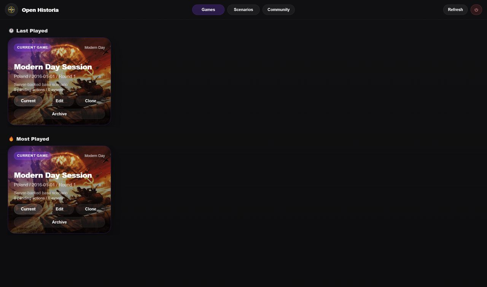

Open Historia saves continuously. There is no save button, and there is no way to lose an hour
of play to a crash.

*The Games tab. Each card carries its country, date and round; **Current** opens it, and its **⋮** holds Edit, Clone and Export.*

## Games and scenarios

Two different things, and the distinction matters:

- A **scenario** is a world — the map, the borders, who owns what, the start date, the available
  troop types, the author's house rules. It never changes when you play.
- A **game** is one playthrough of a scenario. It starts as a copy of that world and diverges
  from the first turn.

One scenario seeds as many games as you like. Editing a scenario later does not rewrite the games
already running on it — each keeps its own world, from who owns what to its events — but a game
draws its regions from its scenario's map, so a border you reshape in the
[map editor](/wiki/editor/) shows in that scenario's games too.

That is also why, when an update replaces the built-in **Modern Day** scenario's map, the
campaigns begun on the old map are not moved onto the new one: they go with the old map into a
scenario of their own, **Modern Day (classic map)**, and carry on there. An update that only
refreshes the built-in scenario's content on the same map leaves your campaigns where they are —
unless you had edited the built-in scenario yourself, in which case your edited copy and the
campaigns on it are kept as **Modern Day (your edited copy)**.

## Autosave

Every time skip writes the whole campaign — world state, game state, events, your order queue,
chat history and the colour palette — and then captures a rollback snapshot.

There is nothing to do and nothing to remember. Closing the game mid-turn loses at most the
orders you had typed but not queued.

## Undo and rollback

**↩ Undo last turn**, in the time panel, restores everything to how it was before the last jump.
The game keeps **12** turns of snapshots, so you can step back repeatedly. The panel tells you
how many are available.

**Roll Back Turn**, in the [cheats panel](/wiki/cheats/), jumps straight to the start of any
earlier turn in the stack and discards everything after it.

Both restore the full campaign, not just the map — the events, the conversations, your queued
orders, your agents' reports and any papers that reached you all come back as they were. Your
standing goal is yours rather than the turn's, so it stays as it is now.

Use undo freely. See [time and turns](/wiki/time/).

## Cloning

Both games and scenarios can be cloned from their card in the library — a game from its **⋮**,
a scenario with **Clone Scenario**.

Cloning a **game** is the closest thing to a manual save slot: fork the campaign before doing
something reckless, and you keep both branches. Cloning a **scenario** gives you an editable copy
of someone else's world.

## Where saves live

**Desktop and self-hosted** — files on disk, in the app's own data directory. You can back the
directory up like any other folder.

**Browser** — in your browser's storage. This is the one to be careful with: **clearing site data
clears your campaigns.** The game will ask for persistent storage permission when you first
play, and you should grant it.

A browser keeps a site's `http://` and `https://` addresses as two separate stores, so games
played on the website before it moved to https were left behind under the old address. The website
brings them across by itself when you open it in that browser: your games and scenarios arrive in
the library beside the ones you already have — nothing here is replaced, and the old copy is left
as it was — along with any settings you have not already set again. If the trip fails, it tries
again later, up to three times in all.

**Android** — on the phone, in the app's storage.

The beta desktop build keeps a **completely separate** library from the stable one. Installing
the beta cannot touch your stable campaigns, and vice versa.

## Moving a campaign between machines

**Games export as one zip.** On a game's card, **⋮ → Export** saves `<name>-game.zip`: the world,
the clock, events, chats, actions, the advisor's conversation, prompts, colours, flags, tags,
intercepts — and every rollback snapshot, so the campaign can be continued and undone on the other
side, not just looked at. The card says so while the zip is being built, and the menu reminds you
that an exported game carries its conversations, advisors and events, worth a look before you post
it anywhere public. **Import game** (**Import Game** on beta), in the Games tab's header, brings one
back; it lands right beside your current game, marked **(Imported)** if its name collides with one
you already have.

The scenario travels only when it has to. A built-in scenario is not included (everyone has it),
nor one that came from the Community Hub (it can be fetched again). A map too large to carry — over
32 MB — is left out rather than crashing the export; the game still exports, and the receiver ends
up in the same position as a game whose scenario is missing. A game whose scenario is gone is still
listed, opens in the editor, and can still be exported.

**Scenarios** export and import as a `.zip` bundle carrying the map, cities, colours, flags and
any custom basemap, or as plain `.json`. Use **Import JSON** (**Import Scenario** on beta) in the
Scenarios tab's header — it takes either form — or the **Download .zip** and **Download JSON**
buttons in a scenario's editor drawer. **Create Scenario** starts a new one as a copy of the
built-in world and drops you straight into its editor. To share one on the Community Hub, use
**⬆ Publish to Hub** in the Community tab, which makes the export for you (see
[the Community Hub](/wiki/community-hub/)).

**In the Android app** an export is saved into the phone's Downloads folder, in a folder of its own
called *Open Historia*, where the Files app and the import picker both find it, and a notice
offers to share it. On Android 10 and older, where the app may not write to Downloads, it goes to
the share sheet instead.

## Syncing between devices

There is none. Earlier versions of the website offered an optional sign-in that synced games
between devices. It has been retired: there are no accounts, nothing of yours is stored on a
server, and the game deletes what an old sign-in left in your browser the next time it opens.

To play the same campaign on another device, move it yourself as described under
*Moving a campaign between machines* above.

If you had an account and want what it stored deleted, see the
[privacy policy](/privacy/).

## Archiving and deleting

**Archive**, on a game's card, takes it out of the main library view without throwing it away, and the same
button becomes **Unarchive** to bring it back. Useful once you have accumulated a dozen
half-finished campaigns.

**Delete**, in a game's or a scenario's editor drawer, removes it after asking. On the stable build
the game has no way to bring it back.

<b>On beta a delete can be undone.</b> Deleted games and scenarios go to a
<b>Recently deleted</b> shelf at the bottom of the Games and Scenarios tabs, each with
<b>Restore</b>, and <b>Empty</b> deletes the shelf's contents for good. The desktop app keeps them
for 30 days; the website and the Android app keep them for a week, and only the last five things
you deleted. On the desktop the shelf is shown only on the computer the game runs on, not to
other devices on your network. An archived game's card also has its own <b>Delete</b>, and
archiving or deleting the game you have open takes you back to the main menu. In <b>All
Games</b>, the <b>Active</b>, <b>All</b> and <b>Archived</b> buttons choose which games are
shown.

## Exporting campaign lore (beta)

In an active single-player campaign, open the Game menu and choose **Campaign Lore** below Game Management. Choose the history scope and dates, optionally include your orders, conversations and completed interactive transcripts, then generate a preview. Download Markdown or JSON, or copy the record. This is an account of retained history, not a reloadable save. Private material is optional and excluded by default; review the exported text before sharing. Intelligence and hidden shared-seat records are excluded. Earlier retained events are included even when no longer in the recent-turn index.

An optional AI chronicle summarizes the selected record through your configured provider. It is clearly labeled as generated, includes source references and does not edit the game. Large selections need a narrower date range or fewer optional sections. Native exports do not need an AI provider.

## What a save contains

For the curious: five documents per game — the world, the game state, the events, the actions
queue and the chat history — plus siblings for colours, flags, tags, rollback snapshots, advisor
history and intercepts. The map geometry is its scenario's.

Intercepts are the exception to "it is all just JSON": they are
[encrypted at rest](/wiki/espionage/) with a key unique to the campaign.

## Next

- [Time and turns](/wiki/time/) — undo in context.
- [The community hub](/wiki/community-hub/) — sharing scenarios.
- [Hosting a server](/wiki/self-hosting/) — where the files actually live.
